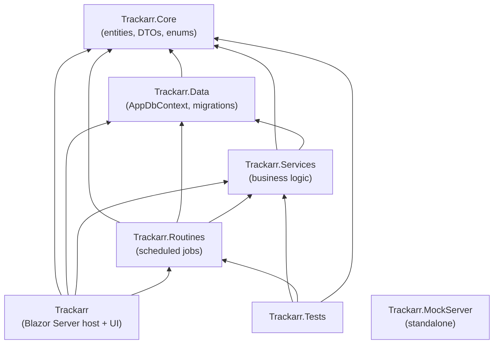
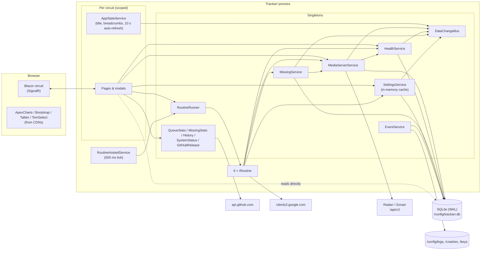
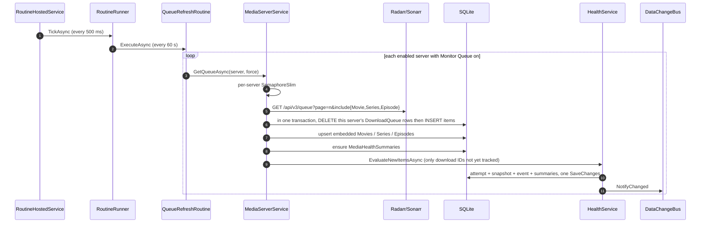
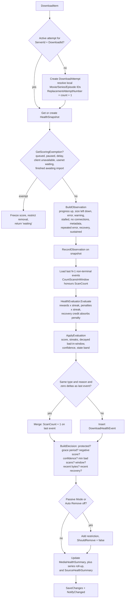
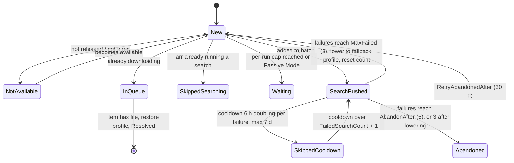
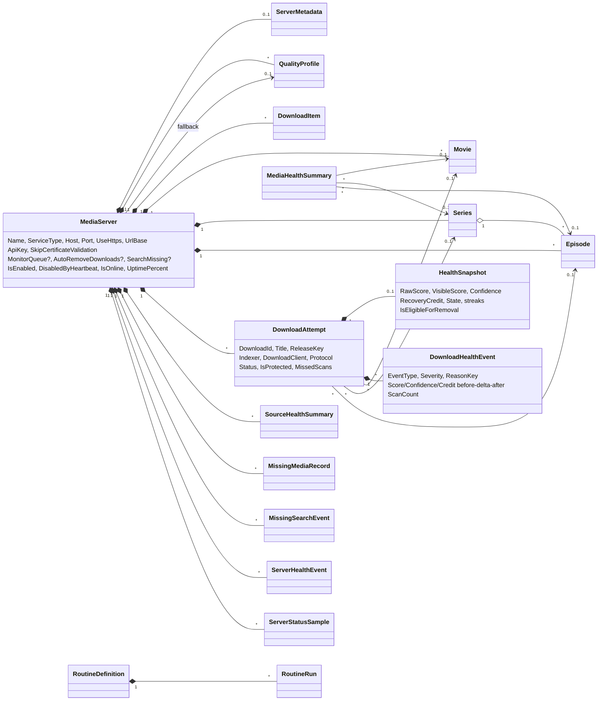
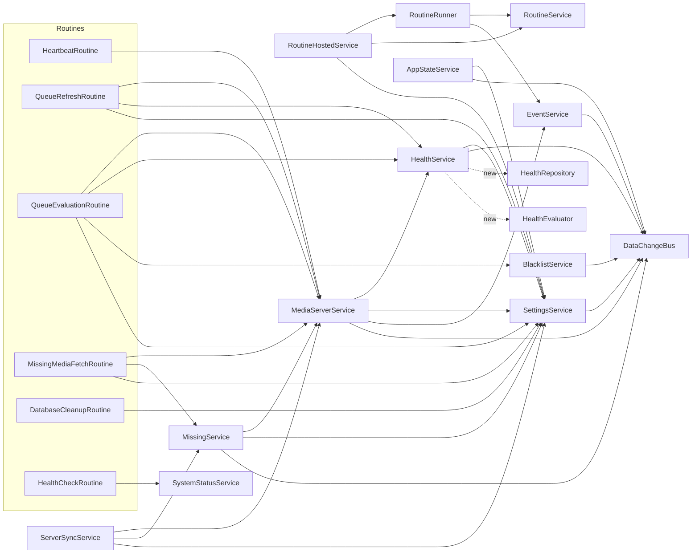
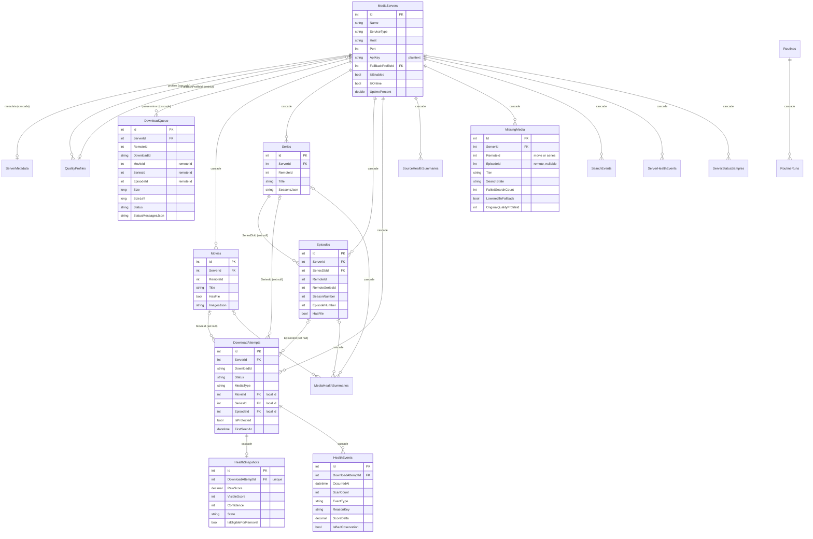
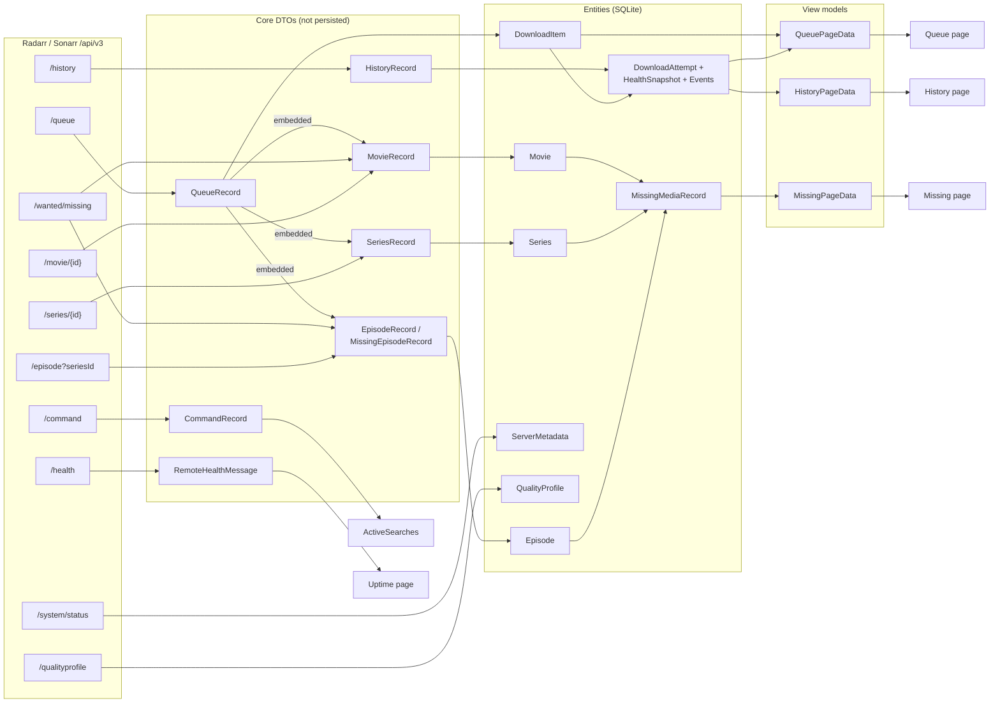

# Trackarr Code Audit

**Version audited:** 6.0.0-alpha (`feature/configurable-routine-intervals`, commit `a25dcb4`)
**Date:** 2026-11-05
**Scope:** every project in `Trackarr.sln`: Core, Data, Services, Routines, the Blazor web app, Tests and MockServer. It also covers the Docker, CI and deploy files, and the running app (reviewed in a browser against two live servers).
**Method:** read every non-migration source file, cross-checked call sites, and reviewed the running UI page by page. No code was changed.

> Links are relative to this file, so they work on GitHub and in Rider. Severity ratings: **Critical**: fix before anyone exposes the app. **High**: fix soon. **Medium**: schedule it. **Low**: polish.

---

## Contents

1. [Executive summary](#1-executive-summary)
2. [Solution layout](#2-solution-layout)
3. [Runtime architecture](#3-runtime-architecture)
4. [Core flows](#4-core-flows)
5. [Class reference](#5-class-reference)
6. [Inheritance and object structure](#6-inheritance-and-object-structure)
7. [Database](#7-database)
8. [Where objects go](#8-where-objects-go)
9. [Findings](#9-findings)
10. [Suggested improvements](#10-suggested-improvements)
11. [Appendices](#11-appendices)

---

## 1. Executive summary

Trackarr is a self-hosted Blazor Server app (.NET 10, EF Core 10, SQLite) that sits beside one or more Radarr and Sonarr
instances. It does four things:

1. **Mirrors the download queue** of every server into SQLite every minute.
2. **Scores each download's health** (0–100, plus confidence and recovery credit) on every scan, and removes and blocklists downloads that stay bad long enough.
3. **Hunts missing media**, with throttled, backed-off searches. It drops to a fallback quality profile when nothing turns up and restores the original profile afterwards.
4. **Monitors server uptime**: heartbeats, uptime history, and Radarr/Sonarr's own health warnings, with automatic disable and re-enable.

### Overall assessment

The domain logic is thoughtful and well commented. Most comments say *why*, which is rare. The June 2026 review items have
mostly landed: `HealthService` is split three ways, record mappers are extracted, the queue page reads health in a batch,
and `IHealthService` is gone. The test suite is substantial, with about 555 test methods in 35 files, and CI runs it
before publishing the Docker image.

The biggest risks are not in the scoring maths. They are at the edges:

| # | Finding | Severity | Section |
|---|---------|----------|---------|
| 1 | **No authentication.** Anyone who can reach the port can read every Radarr/Sonarr API key, remove downloads, reset the database or restart the app. | Critical | [S1](#security) |
| 2 | API keys are stored in plaintext and sent to the browser, even though ASP.NET Data Protection is already configured. | High | [S2](#security) |
| 3 | `MediaServerService` is a 1,888-line god class: HTTP, caching, persistence, summaries and search follow-up all live in it. | High | [A1](#architecture-and-code-quality) |
| 4 | UI pages call Radarr/Sonarr and rewrite tables as a side effect of loading (Queue page, details modal). | High | [P5](#performance-and-scalability) |
| 5 | Decimal settings are parsed with the current culture. On a comma-decimal locale, `1.5` reads as `15`. | Medium | [B3](#confirmed-bugs) |
| 6 | The routine runner's manual queue is a plain `Queue<T>` touched from UI threads and the runner thread. | Medium | [B4](#confirmed-bugs) |
| 7 | One failed heartbeat disables a server and triggers a full re-sync when it comes back. | Medium | [B13](#confirmed-bugs) |
| 8 | History, Events and Missing load whole tables into memory every 10 seconds. Health scoring runs about 25 queries per download per scan. | Medium | [P1/P2](#performance-and-scalability) |
| 9 | Several visible UI bugs: "Next Run: just now" everywhere, badge counts that disagree with page counts, raw `14:04:52:05` time-left values. | Medium | [UI](#103-ui-changes) |
| 10 | Every UI asset (Tabler, Bootstrap, ApexCharts, three icon fonts, the Inter font) loads from public CDNs, so the UI breaks on offline LANs and leaks visitor IPs. | Medium | [S4](#security) |

### Status of the June 2026 review backlog

| Item | Status |
|------|--------|
| Record→entity mapping duplicated | ✅ Done (`MediaRecordMappers`) |
| try/catch duplicated per API call | ✅ Done (`ExecuteApiAsync`) |
| Dead `IHealthService` | ✅ Removed |
| Dead 2-argument `ResolveMissingAttemptsAsync` | ✅ Collapsed into one method with optional parameter |
| N+1 health reads on the Queue page | ✅ Fixed (`HealthService.GetQueueHealthAsync`). Still present in `MediaDetailsModal`, `MissingService` and the Servers page. |
| Split HTTP from persistence (`ArrApiClient`) | ❌ Not started |
| `Directory.Build.props` | ❌ Not added (the six csproj files still repeat TargetFramework, Nullable and ImplicitUsings) |
| Compiler-flagged dead code (`MissingService` logger, `RoutineHostedService` factory, `Exceptions`) | ✅ Cleaned up. The exception types are now used. |

---

## 2. Solution layout

| Project | Kind | Files / lines (excluding migrations) | Responsibility |
|---------|------|-------------------------------------|----------------|
| `Trackarr` | ASP.NET Core web (Blazor Server) | 65 / ~13,400 | Host, DI, startup, Razor components, JS, CSS, Docker |
| `Trackarr.Core` | Class library | 71 / ~2,100 | Entities, DTOs, enums, policies, two tiny UI components |
| `Trackarr.Data` | Class library | 2 / ~500 (+ 44 migrations) | `AppDbContext`, design-time factory, migrations |
| `Trackarr.Services` | Class library | 25 / ~7,300 | All business logic: API client, health engine, missing search, settings, diagnostics, routine runner |
| `Trackarr.Routines` | Class library | 6 / ~980 | The six scheduled background jobs |
| `Trackarr.Tests` | xUnit | 37 / ~10,500 | Unit and SQLite integration tests |
| `Trackarr.MockServer` | ASP.NET Core web | 8 / ~1,760 | Safety proxy between Trackarr and a real Radarr/Sonarr for manual testing |
| `Trackarr.Client` | *(not in the solution)* | 0 | Leftover folder containing only `obj/`. Delete it. |

### Project dependency graph

**Packages** are pinned centrally in `Directory.Packages.props`: EF Core 10.0.8, Microsoft.Data.Sqlite and
`SQLitePCLRaw.bundle_e_sqlite3` 3.0.3 (pinned for GHSA-2m69-gcr7-jv3q), and xUnit 2.9.3. There is no logging library,
HTTP resilience library or UI component library. Everything else is hand-rolled or loaded from a CDN.

---

## 3. Runtime architecture

### Startup sequence ([Program.cs](../Trackarr/Program.cs))

1. Resolve the SQLite connection string: `/config/trackarr.db` in Docker, `Trackarr.Data/trackarr.db` in Development, `./data/trackarr.db` otherwise. Pooling and foreign keys are on.
2. Set `AppPaths.DataDirectory` to the database folder, so logs, crash reports and Data Protection keys sit next to the DB.
3. Read network settings straight from SQLite (`HostingOptions.Load`) before DI exists: port, bind address, URL base and reverse-proxy settings. `ASPNETCORE_URLS` still wins when set.
4. Register services (table below), plus two named `HttpClient`s for the *arr apps (strict TLS and "accept any certificate"). Both honour the outgoing proxy.
5. `MigrateAsync()`, then `PRAGMA journal_mode=WAL`.
6. Ingest crash reports from `/config/crashes` into `LogEvents`.
7. `SettingsService.InitializeAsync()` seeds default settings. `Utils` and the console log level are wired to the settings-changed event.
8. Middleware: forwarded headers (when reverse proxy is on), path base, exception handler, HSTS (outside Development), antiforgery, static files, Razor components, and `GET /health` for the Docker HEALTHCHECK.
9. Write the health URL to `/tmp/trackarr-health-url` so the HEALTHCHECK follows port changes.

### Dependency injection

| Lifetime | Registrations |
|----------|---------------|
| Singleton | `EventService`, `RoutineRunner`, `RoutineService`, `MediaServerService`, `MissingService`, `ServerSyncService`, `HealthService`, `HistoryService`, `QueueStatsService`, `MissingStatsService`, `SystemStatusService`, `GitHubReleaseService`, `SettingsService`, `BlacklistService`, `DataChangeBus`, `HostingOptions`, six `IRoutine` implementations |
| Scoped (per circuit) | `AppStateService` |
| Hosted | `RoutineHostedService` |
| Factory | `IDbContextFactory<AppDbContext>` (each operation gets its own short-lived context) |

Every service is a singleton that creates a fresh `DbContext` per call. That is correct for Blazor Server, where a scoped
`DbContext` would live as long as the circuit. It also means none of these services can hold per-request state.

---

## 4. Core flows

### 4.1 Queue refresh and health scoring

### 4.2 Evaluation pipeline (`HealthService.EvaluateCoreAsync`)

### 4.3 Queue evaluation and removal (`QueueEvaluationRoutine`, every 5 minutes)

For each server: fetch the queue (from cache if it is under 30 seconds old). Skip the server entirely if any item reports
`downloadClientUnavailable`. Dedupe by download ID. For each download:

1. **Blacklist match**: score it, then (unless Passive Mode or Auto Remove is off) `DELETE /queue/{id}?blocklist=true&removeFromClient=true` and `MarkRemovedByTrackarr`.
2. **Just scored by the fetch**: count it and skip it, so the same scan isn't counted twice.
3. **Otherwise** `EvaluateAsync`. If `ShouldRemove`, delete and blocklist it the same way.

Then reconcile attempts that dropped out of the queue: ask `/history?downloadId=…&eventType=3` (one request per ID)
whether they were imported. Imported ones become **Imported**. The rest become **Disappeared** after two consecutive
misses, and that counts as a failure.

### 4.4 Missing-media search (`MissingService.EvaluateServerAsync`, every 15 minutes)

Sonarr items start as one **Series** record. When a series fails `MaxFailedSearches` times and has `MaxEpisodeCascade`
(3) missing episodes or fewer, it **cascades** into one record per episode. Searches go out as one `MoviesSearch`, one
`EpisodeSearch` and one `SeriesSearch` per series, capped at `MaxSearchesPerRun` (10) per server. Each pushed command
is followed up in a fire-and-forget task that polls `/command/{id}` for up to 10 minutes and logs whether anything was
grabbed.

### 4.5 Heartbeat (`HeartbeatRoutine`, every 5 minutes)

Pings `/system/status` on every enabled server, plus servers the heartbeat itself disabled. **One failure disables the
server** and logs a `Down` event. The next success re-enables it, logs `Resolved` and runs a full `SyncServerAsync`.
Every ping writes a `ServerStatusSample` and recomputes `UptimePercent` from all retained samples.

---

## 5. Class reference

### 5.1 Trackarr.Core

Core holds the entity, DTO and enum types. Almost all of them are plain data classes, so they're grouped by namespace.
"Persisted" means the type is mapped by `AppDbContext`.

#### `Trackarr.Core.Server`

| Type | Kind | Persisted | Purpose and notes |
|------|------|-----------|-------------------|
| `MediaServer` | class | ✅ `MediaServers` | One Radarr/Sonarr instance: connection settings (`Host`, `Port`, `UseHttps`, `UrlBase`, `SkipCertificateValidation`, `ApiKey`), behaviour overrides (`MonitorQueue`, `AutoRemoveDownloads`, `SearchMissing`, `RequestTimeoutSeconds`; `null` means use the global default), routine-owned status (`IsOnline`, `LastPingMs`, `LastQueueCount`, `LastError`, `UptimePercent`…) and navigation to `Metadata` and `FallbackProfile`. `BaseUrl` builds the URL. `NormalizeAddress()` splits a pasted full URL into its parts. `Clone()` is a shallow `MemberwiseClone`. **Never used:** `IsDefault` (never set by the UI) and `DownloadsProcessed` (never incremented). `Profiles` and `Queue` are `[NotMapped]` carriers. |
| `ServiceType` | enum | as string | `Radarr`, `Sonarr`. Adding Lidarr or Readarr would touch dozens of `switch` statements; see [10.1](#101-architecture-how-other-apps-are-built). |
| `ServerMetadata` | class | ✅ `ServerMetadata` (PK = `ServerId`) | Deserialized straight from `/api/v3/system/status` (version, OS, branch, auth mode…). 1:1 with `MediaServer`, cascade delete. |
| `QualityProfile` | class | ✅ `QualityProfiles` | `Id` (local) vs `RemoteId` (`[JsonPropertyName("id")]`). Upserted from `/qualityprofile` with a 60-second fetch throttle. |
| `ServerHealthEvent` / `ServerHealthEventType` | class / enum | ✅ `ServerHealthEvents` | Outage log: `Down` or `Resolved`, with message and source. |
| `ServerStatusSample` | class | ✅ `ServerStatusSamples` | One heartbeat result: ping in ms and success. Uptime is computed from these. |
| `RemoteHealthMessage` | record | ❌ | Item from `/api/v3/health`, shown on the Uptime page. |
| `CommandRecord`, `CommandBody` | records | ❌ | `/api/v3/command` list entry, used to find searches already running. |
| `HistoryResponse`, `HistoryRecord` | records | ❌ | `/api/v3/history`, used only to detect imports. |

#### `Trackarr.Core.Queue`

| Type | Kind | Persisted | Purpose and notes |
|------|------|-----------|-------------------|
| `DownloadItem` | class | ✅ `DownloadQueue` | Local mirror of one queue record, **rewritten every refresh** (delete + insert). Stores JSON blobs for languages, quality, custom formats and status messages. `DownloadPercent` is computed. `Quality` and `StatusMessages` deserialize on every access. `State` is `QueueState`, but only 4 of its 11 values are ever mapped (see [B14](#confirmed-bugs)). `SeasonNumber` and `EpisodeNumber` are `[NotMapped]`. |
| `QueueRecord` | class | ❌ | API DTO for `/queue` records, including embedded `Movie`, `Series` and `Episode` `JsonElement`s. |
| `QueueResponse` | class | ❌ | Paging envelope. |
| `QueueState` | enum | as int | Downloading, Importing, PendingImport… |
| `QueueStatus` | enum | ❌ | **Unused.** |
| `DownloadItemTrackingState` | enum | ❌ | **Unused** (an earlier design). |
| `StatusMessageDecode` | class | ❌ | Renders `StatusMessagesJson` as HTML-encoded `MarkupString`. A UI concern living in Core. |
| `QualityModel`, `QualityDetail`, `StatusMessage` | records | ❌ | JSON shapes for the blobs above. |
| `QueuePageData`, `QueueStats`, `QueueStatusBreakdown`, `QueueScoreBucket`, `QueueActivityPoint`, `Trend` | classes / enum | ❌ | View models for the Queue page KPIs and charts. |
| `HistoryTab`, `HistoryFilter`, `HistoryPageData`, `HistoryStats`, `HistoryActivityPoint`, `HistoryBreakdownItem`, `HistoryRow` | view models | ❌ | Everything the History page shows. |

#### `Trackarr.Core.Health`

| Type | Kind | Persisted | Purpose and notes |
|------|------|-----------|-------------------|
| `DownloadAttempt` | class | ✅ `DownloadAttempts` | **The central health entity**: one attempt to download a release, keyed by `(ServerId, DownloadId)` while `Status == Active`. Holds release info (title, normalized title, `ReleaseKey`, client, indexer, protocol), links to local Movie/Series/Episode IDs, lifecycle timestamps, `MissedScans`, final reason and `IsProtected`. 1:1 `HealthSnapshot`, 1:N `HealthEvents`. |
| `AttemptStatus` | enum | as string | `Active`, `Imported`, `RemovedByTrackarr`, `RemovedExternally`, `Replaced`, `Failed`, `Disappeared`, `Unknown`. `Replaced` and `Unknown` are never assigned. |
| `HealthSnapshot` | class | ✅ `HealthSnapshots` | Mutable current state of an attempt: `RawScore` (decimal, −100..100), `VisibleScore` (0..100), `Confidence`, `RecoveryCredit`, `State`, scan counters and streaks, last-seen values for diffing (progress, size left, status, error key), timestamps and the removal decision (`IsEligibleForRemoval`, `RemovalRestrictionReason`). |
| `DownloadHealthEvent` (file `HealthEvent.cs`) | class | ✅ `HealthEvents` | Append-only audit row per scan, or per run of identical scans (`ScanCount`). Records before, delta and after for score, confidence and credit; good/bad flags; and the raw *arr status. The highest-volume table. |
| `HealthEventType` | enum | as string | 22 values: FirstSeen…RemovedByUser. `RecoveryCreditApplied` is chosen but rarely wins the priority. `QueueSeen` is the "nothing changed" type. |
| `Severity` | enum | as string | Trace → Critical. |
| `HealthState` | enum | as string | New, Monitoring, Healthy, Stable, Watching, Degrading, Critical, Remove, Replaced, Resolved, Failed, Unknown. `Monitoring` and `Replaced` are never assigned. |
| `HealthObservation` | class | ❌ | Output of `BuildObservation`: about 30 booleans describing one scan. |
| `HealthDecision` | class | ❌ | Output of `BuildDecision`: `ShouldRemove`, state, scores and the list of `Restrictions` that block removal. |
| `HealthPolicy` | class | ❌ | All scoring knobs, with defaults duplicated from `SettingsService.Defaults`. `SpeedPositiveReward` and `EtaImprovedReward` are kept only so old settings still load. |
| `MediaHealthSummary` (file `HealthSummary.cs`) | class | ✅ `MediaHealthSummaries` | Per-movie, per-series or per-episode roll-up: attempt, failure, removal and success counts, best/worst score, `IsStuck` and reason, search and downgrade counts. **Written by four different code paths** (see [A10](#architecture-and-code-quality)). |
| `SourceHealthSummary` | class | ✅ `SourceHealthSummaries` | Per (server, indexer, client, protocol, release, reason) counters plus a `ReputationScore`. **Written on every scan but never read by anything except cleanup.** This is a dead feature; it would make a good "indexer reputation" page ([F6](#102-features-to-add)). |
| `TrackedMediaType` | enum | as string | Unknown, Movie, Series, Episode. |

#### `Trackarr.Core.Media`

| Type | Kind | Persisted | Purpose and notes |
|------|------|-----------|-------------------|
| `MediaItem` | abstract class | (base) | Shared fields for `Movie` and `Series`: `Id` (local) vs `RemoteId` (`[JsonPropertyName("id")]`), title fields, profile, monitored, IDs (TMDb/IMDb), and JSON blobs (images, genres, tags, ratings, statistics, original language). Computed `Images`, `Genres`, `PosterUrl`… deserialize on every access. |
| `MediaImage`, `MediaLanguage` | records | ❌ | JSON shapes. |
| `Movie` | class : `MediaItem` | ✅ `Movies` | Radarr movie. A mix of missing movies and movies seen in the queue. |
| `Series` | class : `MediaItem` | ✅ `Series` | Sonarr series. `IsAvailable(now)` means it has aired at least once. |
| `Episode` | class | ✅ `Episodes` | Sonarr episode. **Doubles as an API DTO** through `[JsonPropertyName]`, unlike `Movie` and `Series`, which use `*Record` DTOs. `SeriesDbId` is the FK to local `Series`; `RemoteSeriesId` is Sonarr's ID. |
| `MovieRecord`, `SeriesRecord`, `EpisodeRecord`, `MissingEpisodeRecord` | classes | ❌ | API DTOs. JSON sub-objects are kept as `JsonElement` and serialized into the `*Json` columns by `MediaRecordMappers`. |
| `MissingMovieResponse`, `MissingShowResponse` | classes | ❌ | `/wanted/missing` paging envelopes. |

#### `Trackarr.Core.Media.Missing`

| Type | Kind | Persisted | Purpose and notes |
|------|------|-----------|-------------------|
| `MissingMediaRecord` | class | ✅ `MissingMedia` | Search state for one missing movie, series or episode: tier, `SearchState`, `FailedSearchCount`, `LastSearchPushedAt`, `LoweredToFallback`, `OriginalQualityProfileId`. Linked to media only by remote ID (no FK). Unique on `(ServerId, RemoteId, EpisodeId)`, plus a filtered unique index for null `EpisodeId`. |
| `MissingSearchEvent` | class | ✅ `SearchEvents` | Audit log: SearchPushed, SearchFailed, DowngradedToFallback, Resolved, CascadedToEpisode, Abandoned, Retried, ProfileRestored. |
| `MissingSearchState`, `MissingSearchTier`, `MissingEventType` | enums | as string | See the state diagram in [4.4](#44-missing-media-search-missingserviceevaluateserverasync-every-15-minutes). `Stuck` is never assigned. |
| `MissingPolicy` | class | ❌ | Cooldown, max cooldown, max failed, cascade limit, abandon threshold, per-run cap, retry delay. `GetCooldown(n)` doubles the cooldown up to `MaxCooldown`. |
| `ActiveSearches` | class | ❌ | Sets of movie, series and episode IDs with searches already running in the *arr app. |
| `MissingEpisodeCounts` | static class | ❌ | Counts missing episodes per series (used by the Missing page). |
| `SearchStats`, `MissingPageData`, `MissingStats`, `MissingStateBreakdown`, `MissingActivityPoint` | view models | ❌ | Missing and History page KPIs and charts. |

#### `Trackarr.Core.Routine`

| Type | Kind | Persisted | Purpose and notes |
|------|------|-----------|-------------------|
| `IRoutine` | interface | ❌ | `Key`, `Name`, `Description`, `Enabled`, `IntervalSeconds`, `NextRun` and `ExecuteAsync`. Every property is settable, which is more than callers need. Only `Key` and `ExecuteAsync` are used after the first registration. |
| `Routine` | abstract class : `IRoutine` | ❌ | Virtual property defaults. All six jobs derive from it. |
| `RoutineDefinition` | sealed class | ✅ `Routines` | Persisted, user-owned schedule and run state (`Enabled`, `IntervalSeconds`, `IsPaused`, `IsRunning`, `LastRun`, `NextRun`, `LastRunSuccess`, `LastRunTime`). The **same instances** are read by the UI and mutated by the runner thread. |
| `RoutineRun` | sealed class | ✅ `RoutineRuns` | One execution: start, end, state and `ErrorMessage`. The success message is not stored ([B12](#confirmed-bugs)). |
| `RoutineState` | enum | as string | Created, WaitingToRun, Running, Success, Canceled, Failed. |
| `RoutineResult` | sealed record | ❌ | `(Message, Success)`. Converts implicitly from `string`, so a job can report "finished with errors" without throwing. |

#### Other Core namespaces

| Type | Namespace | Persisted | Notes |
|------|-----------|-----------|-------|
| `AppSetting` | Settings | ✅ `AppSettings` | `(Category, Key) → Value` string plus a `Type` hint. Unique on `(Category, Key)`. |
| `BlacklistEntry`, `BlacklistType` | Settings | ✅ `Blacklist` | Pattern (substring or regex) matched against indexer or title. "Release group" is a substring match on the whole title, not a parsed group. |
| `LogEvent` | Event | ✅ `LogEvents` | App event log shown on the Events page. |
| `CrashReport` | Exception | ❌ | Parsed crash file. |
| `MediaServerException` → `ConnectionException`, `ApiException`, `MetadataException` | Exception | ❌ | Domain exceptions. `ConnectionException.Describe` turns socket and TLS errors into plain-English hints. `ApiException.IsAuthFailure` covers 401 and 403. |
| `AppInfo`, `SystemStats`, `DiskSpaceInfo`, `GitHubRelease`, `SystemStatusMessage`, `StatusLevel` | SystemInfo | ❌ | Status page models. `SystemStats` and `DiskSpaceInfo` are **built but never displayed**. |
| `ChartHost`, `StaticRegion` | UI | ❌ | `ComponentBase` subclasses that render once and then refuse to re-render, so JS-owned DOM survives. **`StaticRegion` is unused.** |
| `Option` | UI | ❌ | **Unused** (belongs to the unused `OptionsBanner`). |
| `SettingsPageContext` | UI | ❌ | Shared Save/Discard/dirty-state bus between `SettingsLayout` and each settings page. |
| `JsonHelper` | root | ❌ | Case-insensitive deserialize that swallows errors and returns `default`. |

### 5.2 Trackarr.Data

| Class | Purpose and notes |
|-------|-------------------|
| `AppDbContext` | 21 `DbSet`s and the full fluent model: string-converted enums, max lengths, decimal precisions, 60+ indexes and cascade rules. See [Section 7](#7-database). |
| `AppDbContextFactory` | Design-time factory for `dotnet ef`. It hard-codes `../Trackarr.Data/trackarr.db` relative to the current directory, so it only works when run from a sibling project folder. |
| `Migrations/` | 44 migrations since 2026-05-27. The first 30 have timestamp names (`202606052028`) that say nothing about their content. Later ones are descriptive (`CascadeServerDelete`, `ResetHealthHistory`…). `ResetHealthHistory` deliberately wipes health data once. |

### 5.3 Trackarr.Services

#### `Media/MediaServerService` (1,888 lines): the *arr API client and media repository

**Dependencies:** `IDbContextFactory`, `IHttpClientFactory`, `ILogger`, `DataChangeBus`, `HealthService`, optional `SettingsService` and `EventService` (null in tests).

| Area | Public members | What it does |
|------|----------------|-------------|
| Profiles | `GetProfilesAsync(server, force)`, `SetQualityProfileAsync(server, remoteId, profileId, onlyIfCurrent)` | Upserts profiles (60 s throttle in a **static** dictionary). The profile change does GET → modify → PUT on the whole movie or series, and won't overwrite a profile someone changed by hand when `onlyIfCurrent` is set. |
| Movies | `GetMissingMoviesAsync`, `GetMovieByIdAsync`, `GetParentMovieAsync` | Pages `/wanted/missing` 100 at a time, upserts `Movies`, ensures summaries. |
| Series and episodes | `GetMissingEpisodesAsync`, `GetSeriesByIdAsync`, `GetParentSeriesAsync`, `GetEpisodesBySeriesIdAsync`, `SyncSeriesEpisodesAsync`, `GetSeriesEpisodeStatesAsync`, `GetQueueEpisodesAsync`, `GetQueueEpisodesBySeriesAsync` | The Sonarr equivalents. Upserts series from the `includeSeries` payload instead of fetching each one. |
| Server CRUD | `GetAllServersAsync`, `GetServerByIdAsync`, `CreateServerAsync`, `UpdateServerAsync`, `DeleteServerAsync`, `SyncServerAsync` | `UpdateServerAsync` keeps **routine-owned fields** (ping, queue counts…) from being rolled back by a stale form, then refreshes metadata. `SyncServerAsync` = update + forced queue fetch + forced missing fetch. |
| Connectivity | `TestConnectionAsync`, `UpdateServerStatsAsync`, `GetRemoteHealthAsync`, `LogHealthEventAsync`, `GetRecentHealthEventsAsync`, `RecordStatusSampleAsync`, `GetStatusSamplesAsync` | Classifies failures as connection, auth or other, and writes status onto the server row. `UpdateServerStatsAsync` marks the **whole entity modified** and fires the change bus. |
| Queue | `GetQueueAsync(server, force)`, `RemoveFromQueueAsync(server, id, blocklist, removeFromClient)` | 30-second cache keyed on `LastQueueFetchAt`, per-server `SemaphoreSlim` in a **static** dictionary. Transactional delete+insert of `DownloadQueue`, upserts embedded media, scores new items. |
| Search | `TriggerMovieSearchAsync`, `TriggerMoviesSearchAsync`, `TriggerSeriesSearchAsync`, `TriggerEpisodeSearchAsync`, `TriggerEpisodesSearchAsync`, `GetActiveSearchesAsync`, `GetImportedDownloadIdsAsync` | POSTs `/command`, then **fire-and-forgets** `FollowSearchAsync`, which checks each ID exists (one GET each) and polls the command every 5 seconds for up to 10 minutes. |
| Helpers | `CreateClient`, `ExecuteApiAsync`, `MapQueueState`, `Ensure*Summaries*` | `CreateClient` picks the strict or insecure named client, sets the timeout (per-server, then global, then fallback) and adds `X-Api-Key`. |

#### `Media/HealthEvaluator` (700 lines): the pure scoring engine

There is no I/O here, and it is the best-tested class in the solution.

* `GetScoringExemption(item)`: returns a reason not to score (client unavailable, queued, paused, delay profile, usenet waiting its turn, finished and awaiting import).
* `BuildObservation(item, attempt, snapshot, now)`: diffs the item against the snapshot and returns about 30 flags. Anything actively progressing cancels every "bad" flag. Usenet "no progress" is never bad.
* `RecordObservation`: stores this scan's values on the snapshot for the next diff.
* `Evaluate(...)`: core rewards (progress, size left) are multiplied by the good streak. Core penalties (metadata, stalled-no-connections, stalled, error, warning, no progress, checked in that order with only one applied) are multiplied by the bad streak. Flat rewards and penalties (error cleared, recovery, sustained progress, repeated error, previous failure, downgraded-and-still-failing) are added on top. Recovery credit absorbs penalties. Event type is picked by a fixed priority list.
* `ApplyEvaluation`: clamps the score, updates streaks, applies window decay (each good scan forgives `GoodObservationBadScanDecay` bad ones), recomputes confidence (evidence × max(recent-bad ratio, consecutive-bad ratio)) and maps the score to a state band.
* `BuildDecision`: collects restrictions: protected, inactive, grace period, score ≥ 0, confidence below threshold, too few bad scans, too few bad scans in the window, bytes moved recently, recovered recently. **Remove only when the list is empty.**
* Helpers: `NormalizeTitle`, `NormalizeError` (buckets errors into stalled, not-found, unpack-failed, import-failed…), `HasBeenScored`, `GetDisplayStatus`, `IsDownloadClientUnavailable`.
* Supporting types in the same file: `HealthStateBefore` (record struct) and `HealthEvaluation`.

> **Design note.** With the defaults (escalation 1.5 per scan, cap 8.5), a stalled torrent scores 70 → 52 → 7 → −65 → −100 in four scans. After that the score carries no information, and removal is really decided by the **strike counters** (8 bad scans, 8 of the last 10, confidence ≥ 70). See [A11](#architecture-and-code-quality).

#### `Media/HealthRepository` (388 lines)

Persistence helpers that take the caller's `AppDbContext`, so one evaluation is one unit of work.

* `GetOrCreateAttemptAsync`: finds the active attempt or creates one. Resolves local Movie, Series and Episode IDs (three queries). Sonarr attempts become `Episode`-typed when the episode is known.
* `GetOrCreateSnapshotAsync`, `GetMediaSummaryAsync`.
* `UpdateMediaSummaryAsync`: recomputes counts with **about 11 separate aggregate queries**, twice for episode attempts (episode plus series roll-up). Sets `IsStuck` after 3 or more failures or removals.
* `UpdateSourceSummaryAsync`: upserts the source and reason row and nudges `ReputationScore`.

#### `Media/HealthService` (1,036 lines): orchestrator and read model

* **Writes:** `EvaluateAsync` (records a scan), `PreviewAsync` (same pipeline without `SaveChanges`), `EvaluateNewItemsAsync`, `ResolveMissingAttemptsAsync` (imported or disappeared), `MarkRemovedByTrackarrAsync`, `MarkRemovedByUserAsync`, `SetProtectedAsync`, `SetScoreAsync` (manual override). `MarkImportedAsync`, `MarkFailedAsync`, `GetHistoryAsync` and `GetActiveAttemptsAsync` are internal and only used by tests.
* **Reads:** `GetQueueHealthAsync` (batched for a page of items), `GetAttemptAsync`, `GetSnapshotAsync`, `GetEventsAsync`, `GetEventsForItemAsync`, `GetEventsForMediaAsync`, `GetMostRecentSnapshotAsync` (two overloads), `GetDownloadAttemptsAsync` (two overloads), `GetMediaSummary` (two overloads, missing the `Async` suffix), `GetMostRecentHealthEventAsync`, `GetActiveDownloadIdsAsync`, `GetMissingDownloadIdsAsync`.
* **Static:** `GetDownloadId(item)` (the *arr download ID, or `server:remoteId:normalized-title`) and `CountScansInWindow`.
* Remote-to-local ID resolution is written out four times (`ResolveLocalIdsAsync` plus three inline copies).

#### `Media/MissingService` (605 lines)

`EvaluateServerAsync(server)`: loads records and the queue (possibly cached), finds searches already running, then for
Radarr runs `Reconcile → Process → Send → FallbackAsync`, and for Sonarr runs `Reconcile → Process → Send → Cascade + Fallback`.
It saves after every batch of external calls, so a later failure can't repeat a profile change. It then syncs search
and downgrade counts into `MediaHealthSummaries`. Private helpers: `RunSearchFlow` (the state machine in
[4.4](#44-missing-media-search-missingserviceevaluateserverasync-every-15-minutes)), `RestoreProfileAndRemoveAsync`,
`SendSearchesAsync`, `GetAbandonedAtAsync`, `SyncMediaSummariesAsync`, `AddRecord`, `RemoveRecord`, `AddEvent`.

#### Other `Media/` classes

| Class | Purpose |
|-------|---------|
| `MissingSearchBatch` | Collects up to N searches per run and dedupes IDs. |
| `MediaRecordMappers` (internal) | `ToEntity(serverId)` extensions for Movie, Series and the two Episode record types. Serializes `JsonElement` sub-objects into `*Json` columns. |
| `ServerSyncService` | `SyncAsync` = `SyncServerAsync` + `EvaluateServerAsync`. `SyncInBackground` is fire-and-forget with logging. Used after adding a server and by the Sync Now buttons. |
| `QueueStatsService` | Queue KPIs, status breakdown, score distribution (its own 39/59/79/89 bands), 24 one-hour activity buckets, and trends that compare the first and second half of the day. |
| `MissingStatsService` | The same for the Missing page. `ComputeTrend` is a copy of the queue version. |
| `HistoryService` | Builds the whole History page in memory for a date range: attempts, health events, search events, stats, daily activity and breakdown. No paging. |

#### `Settings/`

| Class | Purpose and notes |
|-------|-------------------|
| `SettingsService` | Owns `AppSettings`. Holds a **static `Defaults` registry** (about 80 keys), a `ConcurrentDictionary` cache loaded at start, typed `Get*` accessors (each repeats the default), `SaveCategoryAsync`, `ResetDatabaseAsync` (FK checks off, wipe every table, reseed, VACUUM), `ResetSettingsAsync`, per-server behaviour resolution (`ShouldMonitorQueue` and friends), and `GetHealthPolicy()` / `GetMissingPolicy()`, which build fresh policy objects on every call. Raises `OnSettingsChanged` and the change bus. |
| `HostingOptions` (record) | Port, bind address, URL base, reverse proxy and trusted proxies. Read from SQLite with raw ADO.NET before DI exists. Provides `ListenUrls`, `LocalHealthUrl`, `BaseHref` and `ParseTrustedProxies` (defaults to loopback plus private ranges). |
| `BlacklistService` | CRUD for `Blacklist`. |

#### `Routines/`

| Class | Purpose and notes |
|-------|-------------------|
| `RoutineHostedService` | `BackgroundService`. Registers each `IRoutine` in the DB (keeping the user's `Enabled` and interval), clears stale `IsRunning` flags, loads definitions into the runner, then ticks every 500 ms. "Auto Start Routines" is read on every tick and only gates scheduled runs. |
| `RoutineRunner` | **Runs one routine at a time** behind a `SemaphoreSlim`. A manual queue (`Queue<string>`) takes priority over the most overdue enabled routine. Logs "started" and "completed" events to `EventService` and writes a `RoutineRun`. Also provides `SetIntervalAsync` (clamped to 60 s–7 d), `ForceResetAsync`, `ResetAsync(wipe)` (used by "Reset all data"), `Definitions`, `IsQueued` and `RunAsync(key)` (which **only enqueues**, despite the name). |
| `RoutineService` | Thin EF wrapper: register, `GetAll`, `GetByKey`, `Update`/`UpdateDefinition` (the two are identical), `SaveRun`, `ResetAllRunning`. |

#### `Diagnostics/`

| Class | Purpose and notes |
|-------|-------------------|
| `AppPaths` (static) | Data, logs and crashes directories, plus `DeleteFilesOlderThan`. |
| `CrashReporter` (static) | Writes `crash_*.log` files from the AppDomain and unobserved-task handlers. `ReadAll` parses them back. |
| `EventService` | `LogAsync` writes **three times**: a `LogEvents` row, a line in the daily log file, and an `ILogger` call. Also `GetAllAsync` (unbounded), `GetByLevelAsync`, `DeleteAsync`, `ClearAllAsync` and `IngestCrashReportsAsync`. |
| `LogFileWriter` | Appends to `trackarr_yyyyMMdd.log` and rolls at 10 MB, under a static lock. Only `EventService` messages reach the file; ordinary `ILogger` output only goes to the console. |

#### `SystemInfo/` and `UI/`

| Class | Purpose and notes |
|-------|-------------------|
| `SystemStatusService` | `GetAppInfoAsync` (cached version, build time, OS, runtime, SQLite version, migration count). `GetStatusMessagesAsync` returns the health-check routine's messages, or a fallback. `GetSystemStatsAsync` and `GetDiskSpaceAsync` are **never called**. `DataDirectory` is computed differently from `AppPaths` ([B6](#confirmed-bugs)). |
| `GitHubReleaseService` | Fetches `api.github.com/repos/alexzeigler/Trackarr/releases` with a 30-minute cache. `GetNewerReleaseAsync` compares numeric versions only. |
| `AppStateService` (scoped) | Page title and breadcrumbs from a hard-coded route table that is missing `/servers/uptime`, `/system/releases` and `/system/license`. Debounces `DataChangeBus` bursts into one refresh per second. Runs a `PeriodicTimer` auto-refresh (default 10 s) that calls each page's `OnRefreshRequested`. |
| `DataChangeBus` | One `event Action OnChanged` with **no payload**, so any change refreshes every open page. |

### 5.4 Trackarr.Routines

| Routine (key) | Default interval | Does | Writes |
|---------------|------------------|------|--------|
| `HeartbeatRoutine` (`heartbeat`) | 5 min | Pings each server. Disables on failure, re-enables and fully syncs on recovery. | `MediaServers`, `ServerHealthEvents`, `ServerStatusSamples` |
| `QueueRefreshRoutine` (`queue_refresh`) | 1 min | Forced queue fetch per server (which also scores new items). | `DownloadQueue`, media tables, health tables |
| `QueueEvaluationRoutine` (`queue-evaluation`) | 5 min | Scores, removes, applies the blacklist and resolves imported or disappeared downloads ([4.3](#43-queue-evaluation-and-removal-queueevaluationroutine-every-5-minutes)). | Health tables; DELETEs on the *arr |
| `MissingMediaFetchRoutine` (`missing_search`) | 15 min | `MissingService.EvaluateServerAsync` per server. | `MissingMedia`, `SearchEvents`, summaries; commands and profile PUTs on the *arr |
| `DatabaseCleanupRoutine` (`database-cleanup`) | 24 h (first run 5 min after start) | Merges duplicate health events, prunes by retention, removes orphaned snapshots and stale source summaries, VACUUMs, deletes old log and crash files. | Everything |
| `HealthCheckRoutine` (`health_check`) | 10 min | Checks internet (Google `generate_204`), `PRAGMA quick_check` and `foreign_key_check`, disk space, server state and staleness, critical downloads, orphaned attempts and failed routines. Pushes messages to `SystemStatusService`. | Memory only |

Routine keys mix `snake_case` and `kebab-case`. They're stable IDs stored in the database, so leave them as they are,
but use one convention for new routines.

### 5.5 Trackarr (web)

#### Host and shared code

| File | Purpose and notes |
|------|-------------------|
| `Program.cs` | See [Startup](#startup-sequence-programcs). Top-level statements mixed with static local functions. |
| `Utils.cs` (static) | About 40 display helpers used across Razor via `@using static`: badge classes, `TimeAgo`, `DateTimeDisplay`, `ToLocal`, score badges, status buckets, interval and duration text, routine status text, SVG check marks, server icons, `AppHref`. It also holds **mutable static display settings** and **a database query** (`GetTotalEpisodeCountAsync`). |
| `Dockerfile` / `docker-entrypoint.sh` | Multi-stage build on `aspnet:10.0`. Installs `curl`, `gosu` and `tzdata`; drops to PUID:PGID (99:100); HEALTHCHECK reads the health URL file. |
| `wwwroot/js/*` | `bootstrapHelper.js` (modal, dropdown portal, tooltips, TomSelect, sidebar), one chart module per page (`queueChart`, `missingChart`, `historyChart`, `uptimeChart`) and `trackarr-table-list.js` (**unused**, as is the list.js CDN script). |
| `wwwroot/app.css` | 937 lines of design tokens and Tabler overrides. Dark theme only. |

#### Layout components

| Component | Purpose and notes |
|-----------|-------------------|
| `App.razor` | HTML shell: `<base href>` from `HostingOptions`, **11 CDN stylesheets and scripts**, `InteractiveServerRenderMode(prerender: false)`. Contains an empty `<script>` tag. |
| `Routes.razor` | Router with `NotFoundPage`, default layout `MainLayout`. |
| `MainLayout` | Sidebar, topbar and an `ErrorBoundary` that recovers when you navigate away. Starts the per-circuit auto-refresh. |
| `AppSidebar`, `NavMenu` | Brand and navigation. `NavMenu` has its own one-minute badge timer (queue count, missing count, disabled servers, status messages). Icon sets are mixed (`ti`, `bi`), and Missing uses the same icon as Queue. |
| `AppTopbar` | Breadcrumbs and title, `TopbarStatus`, `TopbarSearch`, refresh button, GitHub link with an update badge, and a settings dropdown. |
| `TopbarStatus` | Chips for "2/2 online", "104 queued", "360 missing", the current or next routine, and Passive Mode. Has its own 3-second timer. |
| `TopbarSearch` | Navigates to `/?search=…`. Searches the queue only. |
| `SettingsLayout` | Settings side nav and a sticky Save/Discard bar driven by `SettingsPageContext`. |
| `ReconnectModal` | Custom Blazor reconnect UI (CSS and JS). |
| **Unused:** `ServerHealthPills`, `NotificationsMenu` (empty bell with a permanent red dot), `ThemeToggle` (links to `?theme=…`, which nothing handles), `OptionsBanner` | Delete them, or finish them. |

#### Pages

| Route | Component (lines .razor + .cs) | What it shows and does | Notes |
|-------|-------------------------------|------------------------|-------|
| `/` | `Queue` (656 + 1,024) | KPI row, three charts, filterable, sortable, paginated grouped table (by title, server, status or type). Per-item menu: Set Score, Preview, Protect, Details, Remove. | Calls `GetQueueAsync` (which can hit the API); `Groups` is rebuilt on every access; Remove has no confirmation. |
| `/missing` | `Missing` (394 + 638) | KPIs, two charts, grouped missing table, Force Search, details modal. | Queries `AppDbContext` directly; loads all episodes of affected series every refresh. |
| `/history` | `History` (415 + 425) | Date-range filter, acquisition and download KPIs, three charts, five tabs (Download Events, Events, Searches, Health, Changes). | Everything in memory. The Events tab is nearly always empty. |
| `/servers` | `Servers` (345 + 345) | KPI row and server table: test, sync, edit, enable/disable, delete, uptime link. | Per-server query loop for the latest event. |
| `/servers/uptime` | `Uptime` (241 + 363) | Per-server status, response-time chart, remote health warnings, outage log. Repeats the server actions. | `async void SendDeleteToDb`; topbar title reads "Servers". |
| `/system/status` | `Status` (157) | Version, build, uptime and health messages. | Very sparse; app info, disk and stats exist but aren't shown. |
| `/system/routines` | `Routines` (324 + 321) | Routine table (run, pause, disable, edit interval with presets) and recent runs. | "Next Run" always reads "just now" ([B1](#confirmed-bugs)). |
| `/system/events` | `Events` (244 + 224) | Paged log table with level filter and clear button. | Loads every row; dominated by routine start and complete noise. |
| `/system/releases` | `Releases` (124 + 134) | GitHub release notes. | |
| `/system/license` | `License` (102) | License text. | |
| `/settings/*` | `General`, `Display`, `HealthPolicy`, `MissingPolicy`, `Blacklist`, `Server` (route `/settings/services`), `Network`, `Maintenance` | Typed forms that save one category at a time. General has Reset data, Reset settings and Restart. | Three `async void` handlers in `GeneralSettings`. The Health Policy page has about 40 numeric inputs. |
| `/settings` | `Settings` | Redirects to `/settings/general`. | |
| `/system/tasks` | `Tasks` (146) | **Orphan**: an older copy of Routines, using `SettingsLayout` and no nav link. | Delete it. |
| `/System` | `System` | **Stub** (`<h3>System</h3>`). | Delete it. |
| `/Error`, `/not-found` | `Error`, `NotFound` | Framework pages. | |

#### Modals and shared components

| Component | Purpose and notes |
|-----------|-------------------|
| `MediaDetailsModal` (964 + 708 + 171 css) | Overview, Attempts, Activity and Episodes tabs for a movie, series, episode or queue item: health card, current download, attempt history with paged events and score-math tooltips, per-season episode list. Opening it calls the *arr apps (`GetQueueAsync`, `GetMovieByIdAsync`/`GetSeriesByIdAsync`, `SyncSeriesEpisodesAsync`) and runs an N+1 loop over attempts. The `OnForceRecheck` and `OnRemoveFromQueue` parameters are never bound. |
| `AddServerModal` (291 + 284) | Add and edit servers: address parsing, show/hide API key, test connection, load profiles, fallback profile via TomSelect, behaviour overrides, priority. |
| `SetScoreModal` | Manual score and confidence override. |
| `ConfirmationDialog` | Bootstrap modal shown with `modalHelper.show(id)`. |
| `DetailRow` | Label and value row (or a check mark for booleans). |
| `ChartsToggle` | Show or hide a page's charts (saved to Display settings). |
| `NoServersPlaceholder` | Empty state with an "Add Server" link. |

About 30 files are empty scaffolds: 11 empty `*.razor.css`, 12 `*.razor.js` that only declare an empty class, and 7 seven-line `*.razor.cs` stubs. Delete them.

### 5.6 Trackarr.MockServer (summary)

> **Update 2026-11-06:** the MockServer was moved to its own repository (`Trackarr.MockServer`, with history kept).
> This section describes it as it was when audited.

A standalone web app that sits **between Trackarr and a real Radarr or Sonarr** so you can test against real data without consequences:

* `LiveProxy` forwards every GET to the live server, so Trackarr sees a real queue, missing list and library.
* `InterceptStore` and `RequestTracker` answer search commands, queue DELETEs and other writes locally and log them, so nothing changes on the real server.
* `DashboardPage` (served at the Radarr port) shows intercepted actions and edits the live URLs and keys. `UserSecretsStore` saves them and the server restarts in-process.
* `MockSettings` holds the mock's own API key. `CleanConsoleFormatter` tidies the console. `run-mockserver.ps1` restarts it in a loop.

It's a clever and genuinely useful harness. The gap is that it's manual: there's no **recorded-fixture mode** that
replays saved Radarr/Sonarr responses for deterministic integration tests ([T3](#testing)).

### 5.7 Trackarr.Tests (summary)

About **555 test methods** in 35 files (xUnit, in-memory and file-backed SQLite via `SqliteInMemoryFactory` and `SqliteFileFactory`).

| Area | Coverage | Main files |
|------|----------|-----------|
| Health scoring engine | ●●●●● | `HealthEvaluator{Scoring,Observation,Helper,Decision}Tests`, `HealthExemptionTests` (~150 tests) |
| Health lifecycle and persistence | ●●●●○ | `HealthServiceLifecycleTests`, `HealthPipelineTests`, `RedownloadTests`, `ResetHealthHistoryMigrationTests` |
| Settings | ●●●●○ | `SettingsServiceTests`, `NetworkSettingsTests` |
| Core models | ●●●●○ | `CoreModelTests`, `CoreModelExtendedTests`, `StatusMessageDecodeTests`, `MediaRecordMappersTests` |
| Stats services | ●●●○○ | `QueueStatsServiceTests`, `MissingStatsServiceTests`, `MissingEpisodeCountsTests` |
| Routines and runner | ●●●○○ | `RoutineRunnerResultTests`, `RoutineServiceTests`, `HeartbeatRoutineTests`, `HealthCheckRoutineTests`, `QueueRoutineIsolationTests` |
| API client | ●●○○○ | `MediaServerServiceTests`, `QueueRewriteTests`, `RequestTimeoutTests`, `ServerActionFailureTests` (stubbed `HttpMessageHandler`) |
| Missing search | ●●○○○ | `MissingSearchThrottleTests` (one file for a 605-line service) |
| **Not tested** | ○○○○○ | `DatabaseCleanupRoutine`, `MissingMediaFetchRoutine`, `ServerSyncService`, `GitHubReleaseService`, `LogFileWriter`, `RoutineHostedService`, every Razor component, all JS |

---

## 6. Inheritance and object structure

### 6.1 Inheritance

```mermaid
classDiagram
    direction TB

    class Exception
    class MediaServerException
    class ConnectionException
    class ApiException {
        +int StatusCode
        +bool IsAuthFailure
    }
    class MetadataException
    Exception <|-- MediaServerException
    MediaServerException <|-- ConnectionException
    MediaServerException <|-- ApiException
    MediaServerException <|-- MetadataException

    class IRoutine {
        <<interface>>
        +string Key
        +ExecuteAsync(ct) RoutineResult
    }
    class Routine {
        <<abstract>>
    }
    IRoutine <|.. Routine
    Routine <|-- HeartbeatRoutine
    Routine <|-- QueueRefreshRoutine
    Routine <|-- QueueEvaluationRoutine
    Routine <|-- MissingMediaFetchRoutine
    Routine <|-- DatabaseCleanupRoutine
    Routine <|-- HealthCheckRoutine

    class MediaItem {
        <<abstract>>
        +int Id
        +int RemoteId
        +int? ServerId
        +string? ImagesJson
    }
    MediaItem <|-- Movie
    MediaItem <|-- Series

    class DbContext
    DbContext <|-- AppDbContext
    class IDesignTimeDbContextFactory {
        <<interface>>
    }
    IDesignTimeDbContextFactory <|.. AppDbContextFactory

    class BackgroundService
    BackgroundService <|-- RoutineHostedService

    class ComponentBase
    ComponentBase <|-- ChartHost
    ComponentBase <|-- StaticRegion
    ComponentBase <|-- Queue
    ComponentBase <|-- Missing
    ComponentBase <|-- History
    ComponentBase <|-- Servers
    ComponentBase <|-- Uptime
    ComponentBase <|-- MediaDetailsModal
    ComponentBase <|-- AddServerModal
    class LayoutComponentBase
    ComponentBase <|-- LayoutComponentBase
    LayoutComponentBase <|-- MainLayout
    LayoutComponentBase <|-- SettingsLayout
```

There is very little inheritance, and that's a good thing. The only domain hierarchies are `MediaItem` (Movie,
Series), `Routine` (six jobs) and `MediaServerException` (three subclasses). `Episode` is *not* a `MediaItem`, even
though it repeats the image helpers.

### 6.2 Domain object structure

### 6.3 Service dependency graph

All database access goes through `IDbContextFactory<AppDbContext>`, which is left off the graph to keep it readable.

---

## 7. Database

SQLite in WAL mode with foreign keys on and a 30-second command timeout. There are **21 tables** and the schema is
managed by EF Core migrations. Enums are stored as strings, except `QueueState` and `LogLevel`, which are stored as ints.

### 7.1 Entity-relationship diagram

Tables with no relationships: `AppSettings`, `Blacklist`, `LogEvents`.

### 7.2 Table catalogue

| Table | Entity | Written by | Read by | Growth and retention |
|-------|--------|-----------|---------|----------------------|
| `MediaServers` | `MediaServer` | Servers UI, `MediaServerService` (on every ping and fetch) | Everything | Tiny |
| `ServerMetadata` | `ServerMetadata` | `GetSystemStatusAsync` | Servers page | 1 per server |
| `QualityProfiles` | `QualityProfile` | `GetProfilesAsync` | Queue, details modal, missing fallback | Tiny |
| `DownloadQueue` | `DownloadItem` | Queue fetch (**full rewrite every minute**) | Queue page, health check | Size of the live queue |
| `Movies`, `Series`, `Episodes` | media entities | Missing fetch, queue fetch, details modal | Queue, Missing, History, details | Grows with library coverage; **never pruned** |
| `DownloadAttempts` | `DownloadAttempt` | `HealthService` | Queue, History, details, stats | One per release; **never pruned** |
| `HealthSnapshots` | `HealthSnapshot` | `HealthService` | Queue, stats | 1:1 with attempts |
| `HealthEvents` | `DownloadHealthEvent` | `HealthService` (every scan, merged when unchanged) | History, details, trends | Biggest table. 90-day retention, **only for inactive attempts**. |
| `MediaHealthSummaries` | `MediaHealthSummary` | Four writers ([A10](#architecture-and-code-quality)) | Queue, details, scorer | One per media item touched; **never pruned** |
| `SourceHealthSummaries` | `SourceHealthSummary` | `HealthRepository` | **Nobody** (cleanup only) | 90-day retention |
| `MissingMedia` | `MissingMediaRecord` | `MissingService` | Missing page, stats | Size of the missing list |
| `SearchEvents` | `MissingSearchEvent` | `MissingService` | History, Missing charts, abandon timing | **Never pruned** |
| `ServerHealthEvents` | `ServerHealthEvent` | Heartbeat | Servers, Uptime | 90 days (hidden setting) |
| `ServerStatusSamples` | `ServerStatusSample` | Heartbeat (288 per server per day) | Uptime, uptime % | 14 days (hidden setting) |
| `Routines` | `RoutineDefinition` | Runner, Routines page | Runner, topbar, health check | 6 rows |
| `RoutineRuns` | `RoutineRun` | Runner (**about 2,300 per day** at default intervals) | Routines page | 30 days, about 68k rows |
| `LogEvents` | `LogEvent` | `EventService` (**about 4,500 per day**, mostly routine start and complete) | Events page | 14 days, about 63k rows |
| `AppSettings` | `AppSetting` | Settings pages | `SettingsService` cache | About 80 rows |
| `Blacklist` | `BlacklistEntry` | Blacklist page | Queue evaluation | Tiny |

### 7.3 Notable schema details

* **Remote vs local IDs.** `DownloadQueue.MovieId`, `SeriesId` and `EpisodeId` and `MissingMedia.RemoteId` are *arr IDs, while `DownloadAttempts.MovieId` and friends are *local* IDs with real foreign keys. The names are identical, which makes this easy to get wrong. Consider renaming the queue columns to `RemoteMovieId` and so on.
* **JSON columns** (`ImagesJson`, `GenresJson`, `StatisticsJson`, `QualityJson`, `StatusMessagesJson`, `SeasonsJson`…) hold raw *arr sub-documents. They can't be queried, and they're deserialized again on every property access.
* **Index load on `HealthEvents`.** Nine indexes, four of them on booleans (`IsBadObservation`, `IsGoodObservation`, `IsMeaningfulRecovery`, `CountsTowardRemoval`), which barely narrow a SQLite search. Every insert maintains all nine on the hottest table. The real queries use `(DownloadAttemptId, OccurredAt)`, so add that composite index and drop the boolean ones.
* **`MissingMedia` uniqueness** is handled correctly for SQLite's distinct-NULL behaviour with a filtered unique index.
* **Cascades** were fixed in `CascadeServerDelete`: deleting a server removes everything it owns. `FallBackProfileId` is `Restrict`, but the profile is deleted together with its server, so that path is fine.
* **Times** are stored as UTC with `Kind = Unspecified`. `Utils.ToLocal` and `TimeAgo` compensate. Configuring a `DateTime` value converter in EF would remove the need to remember this at every call site.

---

## 8. Where objects go

### 8.1 From the *arr API to the screen

### 8.2 *arr endpoints used

| Endpoint | Method | Caller | Purpose |
|----------|--------|--------|---------|
| `/api/v3/system/status` | GET | Test connection, heartbeat, metadata | Reachability, auth, version |
| `/api/v3/qualityprofile` | GET | `GetProfilesAsync` | Profile list |
| `/api/v3/queue?includeMovie&includeSeries&includeEpisode` | GET (paged) | Queue fetch | Queue plus parent media in one call |
| `/api/v3/queue/{id}?removeFromClient&blocklist&skipRedownload=false` | DELETE | Removal (routine and UI) | Remove, blocklist and search again |
| `/api/v3/wanted/missing?includeSeries` | GET (paged) | Missing fetch | Missing movies and episodes |
| `/api/v3/movie/{id}`, `/api/v3/series/{id}` | GET, PUT | Reconcile, profile change, details modal, search follow-up | Single item, quality profile |
| `/api/v3/episode?seriesId` | GET | Reconcile, details modal | Episode states |
| `/api/v3/command` | POST, GET | Searches, active-search detection | `MoviesSearch`, `EpisodeSearch`, `SeriesSearch` |
| `/api/v3/command/{id}` | GET | Search follow-up | Poll every 5 s for up to 10 min |
| `/api/v3/history?downloadId&eventType=3` | GET (one per ID) | Queue evaluation | Was it imported? |
| `/api/v3/health` | GET | Uptime page | Remote warnings |

Unused endpoints that would help: `/wanted/cutoff` (upgrades), `/queue/bulk` (bulk removal), `/queue/status`
(cheap change detection), `/history/since` (one call instead of one per download), `/blocklist`, `/release` and
webhook "Connections" (push instead of poll).

---

## 9. Findings

### Confirmed bugs

| ID | Severity | Where | What happens |
|----|----------|-------|--------------|
| B1 | Medium | [Utils.cs:101](../Trackarr/Utils.cs#L101), [Routines.razor:149](../Trackarr/Components/Pages/System/Routines.razor#L149) | `TimeAgo` clamps negative differences to zero, so **any future time shows "just now"**. The Routines page's Next Run column says "just now" for every routine, including a daily cleanup that ran 55 minutes ago (seen in the running app). |
| B2 | Low | [HistoryService.cs:133](../Trackarr.Services/Media/HistoryService.cs#L133) | Search events are typed `Episode` or `Series`, so **movie searches show as Series** in History. Use `e.Tier`. |
| B3 | Medium | [SettingsService.cs:225](../Trackarr.Services/Settings/SettingsService.cs#L225), [HealthPolicySettings.razor:383](../Trackarr/Components/Pages/Settings/HealthPolicySettings.razor#L383) | Decimals are written and parsed with `CurrentCulture`, but the seeded defaults are invariant (`"1.5"`). Under a comma-decimal culture (de-DE, fr-FR…), `"1.5"` parses as **15**, so streak multipliers jump about 10×. A culture change between save and load corrupts saved values the same way. Use `CultureInfo.InvariantCulture` on both sides. |
| B4 | Medium | [RoutineRunner.cs:110](../Trackarr.Services/Routines/RoutineRunner.cs#L110) | `_manualQueue` is a `Queue<string>` mutated by UI circuits (`RunAsync`, `Enqueue`) and the runner thread (`Peek`, `Dequeue`) without a lock. Concurrent use can corrupt it or throw. Use `ConcurrentQueue` plus a `ConcurrentDictionary` for de-duplication, or `Channel<string>`. |
| B5 | Low | [MediaServerService.cs:1112](../Trackarr.Services/Media/MediaServerService.cs#L1112) | `UptimePercent` is documented as all-time but is computed from samples kept for 14 days, so it's really a 14-day figure. It also runs two full `COUNT`s per heartbeat. |
| B6 | Low | [SystemStatusService.cs:88](../Trackarr.Services/SystemInfo/SystemStatusService.cs#L88) | `DataDirectory` is the assembly folder outside Docker, not `AppPaths.DataDirectory`, so the disk-space health check can measure the wrong drive. |
| B7 | Low | [HealthService.cs:279](../Trackarr.Services/Media/HealthService.cs#L279) | When an attempt is marked imported, the score is set to 100 *before* the event is built, so `ScoreBefore` is always 100 and the delta is 0. `MarkTerminalAsync` does the same. |
| B8 | Low | [MissingStatsService.cs:96](../Trackarr.Services/Media/MissingStatsService.cs#L96) | "Search Ready" counts any record with a null `LastSearchPushedAt`, which includes In Queue, Not Available and Waiting. In the running app it showed 32 ready while 25 items were already in the queue. |
| B9 | Medium | [GeneralSettings.razor:346](../Trackarr/Components/Pages/Settings/GeneralSettings.razor#L346), lines 371 and 399; [Uptime.razor.cs:228](../Trackarr/Components/Pages/Uptime.razor.cs#L228) | `async void` handlers. An exception there can't be caught and ends the circuit. `Servers.razor.cs` already has a comment explaining why not to do this. |
| B10 | Low | [NavMenu.razor:219](../Trackarr/Components/Layout/Main/NavMenu.razor#L219), `TopbarStatus` | Badges count raw *arr queue and missing records ("104 queued", "360 missing"). The pages count de-duplicated downloads and tracking records ("32 in queue", "41 missing"). Both numbers sit on the same screen. |
| B11 | Medium (likely) | [Queue.razor.cs:405](../Trackarr/Components/Pages/Queue.razor.cs#L405) | "Remove" on a group sends one DELETE per queue row. A season pack is one download with many rows, so after the first DELETE removes it from the client the rest probably return 404. `ApiException` then aborts the loop before `MarkRemovedByUserAsync` runs for those rows, and the page lands in the `ErrorBoundary`. De-duplicate by download ID or use `/queue/bulk`. |
| B12 | Low | [RoutineRunner.cs:57](../Trackarr.Services/Routines/RoutineRunner.cs#L57) | Only failed runs store a message, so the Recent Runs "Message" column is always "—" on success (seen in the running app). Add `RoutineRun.Message`. |
| B13 | Medium | [HeartbeatRoutine.cs:81](../Trackarr.Routines/HeartbeatRoutine.cs#L81) | A single failed ping (a transient DNS blip or a Radarr restart) disables the server, hides its queue (with "hidden" disabled-server behaviour) and later triggers a full re-sync. Require N consecutive failures (say 3), or a failure lasting longer than X minutes. |
| B14 | Low | [MediaServerService.cs:1778](../Trackarr.Services/Media/MediaServerService.cs#L1778) | `MapQueueState` maps 4 of 11 `QueueState` values. Everything else (importBlocked, failedPending, …) becomes `Unknown`. |
| B15 | Low | [HealthEvaluator.cs:88-94](../Trackarr.Services/Media/HealthEvaluator.cs#L88) | "Fetching metadata" applies a −20 core penalty and counts as a bad observation, but gets `Severity.Info`, so History shows it as "Success". |
| B16 | Low | [HistoryService.cs:334](../Trackarr.Services/Media/HistoryService.cs#L334) | `StatusFromSeverity` matches `"success"` and `"error"`, which aren't `Severity` values. `Positive` and `Negative` fall through and show raw. |
| B17 | Low | [Missing.razor.cs:267](../Trackarr/Components/Pages/Missing.razor.cs#L267) | Force Search on a series sends a whole `SeriesSearch`, even when one episode is missing. It doesn't update the `MissingMediaRecord`, so the routine may search again minutes later, and the user gets no feedback. |
| B18 | Low | [DatabaseCleanupRoutine.cs:36](../Trackarr.Routines/DatabaseCleanupRoutine.cs#L36) | Cleanup reads `ServerHealthEventRetentionDays` and `ServerStatusSampleRetentionDays`, which are missing from `SettingsService.Defaults` and the Maintenance page, so they can't be changed. |
| B19 | Low | `compose.yaml:7` | The repository's `compose.yaml` still maps `5264:8080` and sets `ASPNETCORE_URLS`, which contradicts the v6 README and release notes (port 8585, remove that variable). |
| B20 | Verify | Status page | The running build showed **5.1.0-alpha** while `Trackarr.csproj` says `6.0.0-alpha`. This may just be a stale Rider build, but check that the version flows into `AssemblyInformationalVersion`. |
| B21 | Low | Details modal | Time Left shows the raw *arr value (`14:04:52:05`). For a season pack, the child row shows the first episode's title ("Session #2: Stray Dog Strut") instead of "Season 1 pack". |

### Security

| ID | Severity | Finding | Recommendation |
|----|----------|---------|----------------|
| S1 | **Critical** | No authentication or authorization (`AddAuthentication` appears nowhere). Anyone who can reach the port can remove and blocklist downloads, change quality profiles, reset the database, restart the app and read API keys. The Network settings encourage reverse-proxy and URL-base setups, which makes exposure likely. Sonarr v4 made authentication **mandatory** for the same reason. | Add Forms login (cookie auth with a hashed password) on first run. Offer "Disabled for local addresses" with the same trusted-network list used for the reverse proxy. Add an optional API key for the `/api` you'll eventually want. |
| S2 | High | API keys are stored in plaintext in `MediaServers.ApiKey` and bound into the edit modal ([AddServerModal.razor:156](../Trackarr/Components/Modals/AddServerModal.razor#L156)), so they travel to every browser that opens it. Proxy credentials sit in `AppSettings` in plaintext. | Encrypt at rest with the Data Protection keys you already persist (`IDataProtector`). Show a masked "••••1a2b" value with a "replace key" field and never send the real key to the client. |
| S3 | Medium | Destructive actions (Remove, Reset data, Restart) aren't protected by any role and some have no confirmation. Remove from queue always blocklists ([Queue.razor:625](../Trackarr/Components/Pages/Queue.razor#L625)). | Confirmation dialog with options (blocklist, remove from client, search again), plus authentication from S1. |
| S4 | Medium | 11 stylesheets and scripts come from jsDelivr, cdnjs and rsms.me with **no Subresource Integrity**. The health check also calls `clients3.google.com` every 10 minutes and GitHub on every page load (cached 30 minutes). | Bundle assets locally (LibMan or npm to `wwwroot/lib`). Make the internet check and update check optional in Settings > General. |
| S5 | Low | Blacklist regexes run without a timeout ([QueueEvaluationRoutine.cs:199](../Trackarr.Routines/QueueEvaluationRoutine.cs#L199)). | `new Regex(pattern, options, TimeSpan.FromMilliseconds(100))`, or validate when saving. |
| S6 | Info | Good practice already in place: non-root container via `gosu`, HSTS outside Development, antiforgery, HTML-encoded status messages (with a test), opt-in insecure TLS per server, trusted-proxy list for forwarded headers, a pinned SQLite CVE fix. | Keep it up. |

### Performance and scalability

| ID | Severity | Finding | Recommendation |
|----|----------|---------|----------------|
| P1 | Medium | `HealthRepository.UpdateSummaryAsync` runs about 11 aggregate queries, twice for every Sonarr episode attempt. Add source-summary and window queries and it comes to roughly 25 queries per download per scan. With 100 downloads that's about 2,500 queries every 5 minutes. | Compute the roll-up in one `GROUP BY` projection, or stop storing `MediaHealthSummary` counts and compute them when read (they're cheap with an index on `(MediaType, MovieId/SeriesId/EpisodeId, Status)`). |
| P2 | Medium | History, Events and Missing load **whole tables** and page in memory, then repeat it every 10 seconds per open tab. Missing also loads every episode of every affected series. | Server-side `Skip`/`Take`, filters and sorting (QuickGrid `ItemsProvider` or `Virtualize`). Only refresh visible data. |
| P3 | Low | `Queue.Groups` is an expression property that runs `BuildGroups()` (filter, group, sort) on every access. `PagedGroups` and `TotalPages` each call it, several times per render. | Compute it once per data or filter change and cache the result. |
| P4 | Medium | Auto-refresh redraws every chart, recomputes trends twice (`RefreshAsync` and `RefreshChartsAsync` both call `ComputeTrendsAsync`) and re-queries activity every 10 seconds per tab. | Refresh charts on a slower cadence (60 s) or only when data actually changes. Make `DataChangeBus` events typed so pages refresh only on relevant changes. |
| P5 | High | **UI page loads cause external API calls and writes.** `Queue.RefreshAsync` calls `GetQueueAsync` ([Queue.razor.cs:507](../Trackarr/Components/Pages/Queue.razor.cs#L507)), which fetches from the *arr apps when the cache is over 30 seconds old, rewrites `DownloadQueue` and scores new items. The details modal syncs every episode of a series on open. The NavMenu comment says "Never call Radarr/Sonarr from the UI here", and the pages do anyway. | Pages read the database only. "Refresh" queues the `queue_refresh` routine. The details modal reads local data and offers an explicit "Sync from Sonarr" button. |
| P6 | Medium | The routine runner is strictly serial. A large missing scan (paging thousands of episodes, profile PUTs) delays heartbeat and queue refresh, and with a 30-second timeout across several offline servers, heartbeats queue up too. | Run each routine on its own loop (one `Task` per routine, each with its own semaphore). Keep a global lock only for the database-reset path. |
| P7 | Medium | `MissingService` does list scans inside loops (`records.FirstOrDefault`, `queue.Any`, `eventCounts.FirstOrDefault`), which is O(n·m), plus N+1 queries ([MissingService.cs:213](../Trackarr.Services/Media/MissingService.cs#L213), [522](../Trackarr.Services/Media/MissingService.cs#L522)). | Build dictionaries and hash sets once per run. Batch-load series and summaries. |
| P8 | Low | Nine indexes on `HealthEvents`, four on booleans. | See [7.3](#73-notable-schema-details). |
| P9 | Low | Every heartbeat and fetch writes the whole `MediaServers` row (`EntityState.Modified`) and raises the change bus, which refreshes every open page. | Use `ExecuteUpdateAsync` on the changed columns. Raise a typed `ServerStatusChanged` event. |
| P10 | Low | About 4,500 `LogEvents` and 2,300 `RoutineRuns` a day, mostly routine start and complete chatter. | Don't write start and complete rows to `LogEvents` (the `RoutineRuns` table already records them). Log at Debug instead. |
| P11 | Low | `[NotMapped]` JSON properties (`Images`, `Genres`, `Quality`, `StatusMessages`, `PosterUrl`) deserialize on every access, inside render loops. | Cache with `Lazy<T>`, or use EF Core owned JSON columns (`ToJson()`). |
| P12 | Low | `FollowSearchAsync` is fire-and-forget, polls for 10 minutes, isn't cancelled on shutdown and checks existence with one GET per ID. | A hosted "command watcher" with a shutdown token, checking existence in one batch. |
| P13 | Low | `GetImportedDownloadIdsAsync` sends one `/history` request per missing download ID. | One `/history/since?date=…&eventType=downloadFolderImported` call per evaluation. |

### Architecture and code quality

| ID | Finding | Recommendation |
|----|---------|----------------|
| A1 | `MediaServerService` (1,888 lines) mixes HTTP, caching (static dictionaries), EF upserts, health summaries and search follow-up. | Split into `ArrApiClient` (typed and stateless: one class per *arr with Radarr and Sonarr subclasses), `MediaRepository` (upserts), `QueueSyncService` (fetch, store, score), `SearchCommandService` (trigger and follow) and `ServerRepository` (CRUD and status). |
| A2 | `Trackarr.Core` depends on `Microsoft.AspNetCore.Components.Web` and EF Core (`ChartHost`, `StaticRegion`, `MarkupString` in `StatusMessageDecode`, and `[ForeignKey]`/`[NotMapped]` attributes). | Move the UI components and `StatusMessageDecode` into the web project. Configure EF purely in `AppDbContext`, so Core has no dependencies. |
| A3 | Entities double as API DTOs inconsistently: `Episode`, `QualityProfile`, `ServerMetadata` and `DownloadItem` (partly) are deserialized directly, while `Movie` and `Series` go through `*Record` DTOs. | Use DTOs everywhere (`*Record` → mapper → entity), and keep `[JsonPropertyName]` off entities. |
| A4 | Stringly-typed settings, with each default written in up to **four places**: `SettingsService.Defaults`, the accessor's default argument, the `HealthPolicy` and `MissingPolicy` initializers, and the settings page. Keys are string literals spread across about 25 files. | Use typed settings objects per category (`GeneralOptions`, `DisplayOptions`, `HealthPolicy`…), serialized as one JSON row per category or reflected into key/value rows with InvariantCulture. Validate them with DataAnnotations. Expose them as `IOptionsMonitor<T>`. This also fixes B3 and B18. |
| A5 | Mutable static state: `Utils` display settings, `AppPaths`, `CrashReporter.LastError`, `MediaServerService.ProfileFetchTimes` and `QueueLocks`, and the `LogFileWriter` lock. | Make these injectable singletons. Statics leak between tests and make parallel tests flaky. |
| A6 | Pages bypass the service layer: `Missing` and `Routines` inject `IDbContextFactory` directly, and `Utils` has a database helper. | Add `MissingQueryService` and `RoutineQueryService`. Keep components free of EF. |
| A7 | `DataChangeBus` carries no payload. | Typed events such as `QueueChanged(serverId)`, `ServerStatusChanged(serverId)`, `MissingChanged`, `SettingsChanged(category)` and `DownloadRemoved(attemptId)`. Notifications ([F1](#102-features-to-add)) would hook in here too. |
| A8 | Duplicated logic: two status-bucket functions with **different rules** (`Utils.GetStatusBucket` vs `QueueStatsService.GetStatusBucket`); **three score scales** (policy 85/65/40/15, badges 39/69/89, distribution 39/59/79/89); `ComputeTrend` twice; `FormatBytes` and `FormatDuration` three or more times each; local-ID resolution four times; Servers and Uptime each implement edit, toggle, sync, test and delete. | One `ScoreBands` derived from `HealthPolicy`, one `StatusClassifier`, one `Format` helper, one `ServerActions` component. |
| A9 | Dead code: `QueueStatus`, `DownloadItemTrackingState`, `Option`, `StaticRegion`, `OptionsBanner`, `ServerHealthPills`, `NotificationsMenu`, `ThemeToggle`, `System.razor`, `Tasks.razor`, `trackarr-table-list.js` and the list.js CDN, `GetSystemStatsAsync`, `GetDiskSpaceAsync`, `MediaServer.IsDefault`, `MediaServer.DownloadsProcessed`, `MediaDetailsModal.OnForceRecheck`/`OnRemoveFromQueue`, enum values that are never assigned (`HealthState.Monitoring`/`Replaced`, `AttemptStatus.Replaced`/`Unknown`, `MissingSearchState.Stuck`), about 30 empty scaffold files, the `Trackarr.Client/` folder, and stale `_ContentIncludedByDefault` entries in the csproj. | Delete, or turn into features (SystemStats, disk space and source reputation are worth showing). |
| A10 | `MediaHealthSummary` rows are created or updated by `MediaServerService.Ensure*` (three places), `HealthRepository.UpdateSummaryAsync` and `MissingService.SyncMediaSummariesAsync`. Nobody owns it, and its invalidation is ad hoc. | One `MediaSummaryService`, or make it a computed read model (see P1). |
| A11 | **The score model saturates.** Streak multipliers (1.5× per scan, capped at 8.5×) push a stalled download from 70 to −100 in about four scans. Removal is then decided by strike counters (8 bad scans, 8 of the last 10, confidence ≥ 70), not the score. The 40 knobs on the Health Policy page are hard to reason about because most of them only affect a number that is already pinned at −100. | Model it explicitly as a **strike system with a health score for display**, as Cleanuparr and Decluttarr do: N consecutive or windowed strikes per rule, reset on progress. Keep the score as an exponentially weighted moving average that stays informative. Add a policy simulator ([U10](#103-ui-changes)). |
| A12 | Optional constructor parameters exist only for tests (`SettingsService? settings = null`, `EventService? eventService = null`, `ILogger? logger = null`), which leaves null-guarded production paths behind. | Inject fakes in tests (`NullLogger`, a fake `SettingsService` behind an interface). |
| A13 | Naming: `RunAsync` is synchronous and only enqueues; `GetMediaSummary` is async without the suffix; the `HealthEvent.cs` and `HealthSummary.cs` file names don't match their types; "Blacklist" is called "blocklist" in Radarr and Sonarr. | Rename: `Enqueue`, `GetMediaSummaryAsync`, matching file names, Blocklist. |
| A14 | No `Directory.Build.props`. TargetFramework, Nullable and ImplicitUsings are repeated in six csproj files. The test project has no `TreatWarningsAsErrors` and no analyzers. | Add it, along with `<AnalysisLevel>latest-recommended</AnalysisLevel>` and `TreatWarningsAsErrors` for Release. |
| A15 | 44 migrations in the alpha period, 30 of them named only by timestamp. | Before 1.0 or a public beta, squash them into one baseline (old databases can be detected and migrated once). |

### Testing

| ID | Finding | Recommendation |
|----|---------|----------------|
| T1 | `MissingService` (605 lines, external side effects) is covered by a single test file. Cascade, fallback, profile restore and abandon/retry are the riskiest paths in the app. | Table-driven tests per transition in [4.4](#44-missing-media-search-missingserviceevaluateserverasync-every-15-minutes), using a fake `ArrApiClient` once A1 lands. |
| T2 | No component tests. | Add bUnit for Queue grouping and paging, the confirmation flows and the settings save/discard flow. |
| T3 | No contract tests against real Radarr/Sonarr JSON. | Record fixtures with the MockServer (add a "record" mode) and replay them in tests. This catches *arr API changes. |
| T4 | Untested: `DatabaseCleanupRoutine` (it deletes data), `MissingMediaFetchRoutine`, `ServerSyncService`, `GitHubReleaseService`, `LogFileWriter`, `RoutineHostedService`. | Cleanup deserves tests first because it deletes data. |
| T5 | CI runs tests but there's no coverage report or gate, and the image is `linux/amd64` only. | Add `coverlet` output to the summary, and build `linux/arm64` (Raspberry Pi and Synology users). |

---

## 10. Suggested improvements

### 10.1 Architecture: how other apps are built

Radarr and Sonarr (the Servarr codebase) solve the same problems Trackarr has. Patterns worth borrowing:

| Pattern (where it comes from) | What it looks like there | What it means for Trackarr |
|-------------------------------|--------------------------|----------------------------|
| **Mandatory auth** (Sonarr v4, Radarr v5) | Forms login on first run, optional "Disabled for local addresses", API key for automation | S1. This is the single most important change. |
| **Command queue with per-command concurrency** (Servarr `CommandQueueManager`) | Every action, scheduled or manual, is a command. Some are exclusive and others run in parallel. The UI shows queued, running and completed commands. | Replace the single-lock runner with per-routine loops. Make UI actions ("Sync", "Force Search", "Remove") commands too, so they're tracked, deduplicated and visible on the Routines page. |
| **Resource-scoped push updates** (Servarr SignalR `ModelEvent<T>`) | The UI subscribes per resource and gets "queue updated" or "series 12 updated" | Typed `DataChangeBus` events (A7), so pages patch their state instead of reloading everything every 10 seconds. |
| **Webhook / Connections** (*arr "Settings > Connect") | Radarr and Sonarr POST on Grab, Import, Health Issue and Manual Interaction Required | Expose `POST /api/webhook/{serverId}` and auto-register it on each server. React to imports and grabs immediately, poll less and resolve attempts exactly instead of guessing "Disappeared". |
| **Typed config** (Servarr `IConfigService`, ASP.NET `IOptionsMonitor<T>`) | Strongly-typed properties, defaults in one place, validated | A4. |
| **Thin API layer** (Servarr `/api/v3` used by its own UI) | The UI is just a client of the API | Add a small read-only `/api/v1` (queue, missing, stats, health) behind the API key. It enables Homepage and Homarr widgets, Prometheus and scripts, and makes the UI logic testable. |
| **Typed HTTP clients with resilience** (`Microsoft.Extensions.Http.Resilience`) | Retries with jitter, circuit breaker per host | `ArrApiClient` plus a standard resilience handler. This also smooths over B13. |
| **Structured logging** (Serilog in Servarr) | One pipeline to console, rolling file and DB | Replace `EventService`'s triple write and `LogFileWriter` with Serilog sinks. `EventService` becomes a query service for the Events page. |
| **Backups** (Sonarr "System > Backup") | Scheduled zip of DB and config, with restore from the UI | Use SQLite's `VACUUM INTO '/config/backups/trackarr_yyyyMMdd.db'` before migrations and on a schedule. |
| **Download-client integration** (Cleanuparr, Decluttarr, qbit_manage) | Talk to qBittorrent, Deluge, Transmission and SABnzbd directly | The *arr queue reports speed and peers less accurately than the client does. Direct access enables accurate stall detection, seeding cleanup and file inspection ([F3](#102-features-to-add)). |
| **Self-contained frontend** (all *arr apps ship their bundle) | Works offline, no third-party requests | S4: bundle Tabler, Bootstrap, ApexCharts and one icon set locally. |

### 10.2 Features to add

Ranked by value for effort, and compared with what the closest tools offer today
([Cleanuparr](https://cleanuparr.github.io/Cleanuparr/), [Decluttarr](https://github.com/ManiMatter/decluttarr) and
[Huntarr](https://github.com/plexguide/Huntarr.io)).

| ID | Feature | Why | Who already has it | Effort |
|----|---------|-----|--------------------|--------|
| F1 | **Notifications** (Discord, Apprise, ntfy, Gotify, Notifiarr, email) on removal, server down/up, item abandoned, profile lowered, plus a daily or weekly digest | Users want to *know* what an automation did. Trackarr already has every event; it just doesn't tell anyone. | Cleanuparr (Notifiarr, Apprise), all *arr apps | M |
| F2 | **Cutoff-unmet upgrade hunting** via `/wanted/cutoff`, with its own per-run cap and cooldown | The second half of what Huntarr does. Trackarr's throttled search engine is already built for it. | Huntarr | S |
| F3 | **Download-client integration** (qBittorrent first): real speed, peers, availability; protect by tag; malware/extension check (`.exe`, `.lnk`, `.scr` inside a "movie"); seeding cleanup by ratio or time; orphaned downloads no *arr references | Better stall detection and a whole new cleanup category. | Cleanuparr (queue cleaner, malware blocker, download cleaner), Decluttarr (protected tag), qbit_manage | L |
| F4 | **Webhook ingestion** from Radarr and Sonarr (Grab, Import, Health) | Instant reactions, fewer polls, exact import detection | Notifiarr, Overseerr | M |
| F5 | **Dry-run report** for Passive Mode: a "would have removed, searched or lowered" log and daily summary | Builds trust before turning automation on. Passive Mode today just stops actions silently. | Cleanuparr (dry run) | S |
| F6 | **Indexer and release-group reputation** page: failure rate, average health, removals per indexer and client, built from `SourceHealthSummary` (already collected, never shown) | Tells users which indexer to drop. No competitor shows this well, so it's a differentiator. | — | S |
| F7 | **Per-tag and per-profile rules**: different health or missing policies for, say, "4K" or "anime", plus a `trackarr-protect` tag in Radarr/Sonarr that protects downloads | One global policy rarely fits a 4K and a 1080p library | Decluttarr (tags), Cleanuparr (per-category rules) | M |
| F8 | **Search scheduling**: quiet hours, a daily indexer API budget, spreading searches through the day | Indexers rate-limit, and users already worry about this | Huntarr (caps, hourly limits) | S |
| F9 | **Remove dialog with options** (remove from client, blocklist, search again, reason) and **bulk actions** (multi-select remove, protect, re-score) | Matches Radarr and Sonarr's own remove dialog. Today Remove is a one-click, always-blocklist action. | Radarr, Sonarr | S |
| F10 | **Import-blocked assistant**: show the exact reason ("Manual import required: sample file"), deep-link to the *arr manual import page and offer "remove if blocked for X hours" | The most common stuck state the health score can't fix | Cleanuparr (failed import rule) | S |
| F11 | **Lidarr, Readarr and Whisparr support** behind an `IArrAdapter` (same `/api/v1` shape, different resources) | Bigger audience. Huntarr and Cleanuparr both cover them. | Huntarr, Cleanuparr | L |
| F12 | **Read-only API and Homepage widget**, plus a Prometheus `/metrics` endpoint | Self-hosters love dashboards | Most *arr tools | S |
| F13 | **Backup and restore, and export/import of settings** (JSON) | Safe upgrades, easy migration | *arr apps | S |
| F14 | **Per-download score timeline** (sparkline in the row, full chart in the modal) built from `HealthEvents` | Makes "why is this at risk?" visible at a glance | — | S |
| F15 | **Uptime windows** (24 h, 7 d, 30 d) and status bars in the style of Uptime Kuma | The current percentage is unclear (B5) | Uptime Kuma | S |

### 10.3 UI changes

These come from reviewing the running app at 1440×900 and at narrow widths, plus the Razor source.

#### Information architecture

| ID | Change | Why |
|----|--------|-----|
| U1 | Add an **"Attention" home page** ahead of the Queue: at-risk downloads, removals in the last 24 hours, abandoned or stuck missing items, offline servers, failed routines, Passive Mode status. The Queue becomes a tab. | Today the landing page spends the first screen on KPIs and three charts, and the actual queue starts below the fold. Most visits are "is anything wrong?" |
| U2 | **Make the counts agree.** Either badges count downloads (32) and tracked items (41), or the page shows both ("32 downloads · 104 items"). | B10: "104 queued" in the topbar and "32" on the page, side by side. |
| U3 | Fix page titles and breadcrumbs for Uptime, Releases and License (the Uptime page is titled "Servers"). Better still, drive titles from each page's `<PageTitle>` instead of a hard-coded route table in `AppStateService`. | Consistency |
| U4 | Make the topbar search **global** (queue, missing, history, servers) with a results dropdown. | Today it only filters the Queue. |
| U5 | Delete the dead UI (notification bell with a permanent red dot, theme toggle, OptionsBanner). Either build a light theme or commit to dark only. | Dead controls hurt trust |

#### Queue page

| ID | Change |
|----|--------|
| U6 | Put the table first. Collapse charts by default (or move them to an "Insights" tab) and keep a compact KPI strip. |
| U7 | Render **single-download groups as one row**. Today every movie shows a header row plus an identical child row. |
| U8 | Add optional columns through a column picker: **speed, ETA (formatted), size, indexer, client, protocol, age, strikes and why it's at risk**. "Seen" and "Evaluated" are cryptic; rename them "First seen" and "Last checked". |
| U9 | Show season packs as "S01 pack · 26 episodes" (B21). Format Time Left as "14d 4h". |
| U10 | Replace one-click Remove with the options dialog (F9). Add multi-select and a bulk action bar. |
| U11 | Turn the score badge into a button with a tooltip explaining the score ("Stalled 3 checks in a row · −45 · 2 more strikes to removal"). Users trust automation they can understand. |

#### Missing page

| ID | Change |
|----|--------|
| U12 | Show **next search time** ("next search in 5 h"), search count, backoff stage and "lowered to fallback" for each row. The state badge alone ("Cooldown") doesn't say when. |
| U13 | Force Search should give feedback (a toast saying it was pushed), search only the missing episodes, and record the search on the item (B17). |
| U14 | Fix the "Search Ready" metric (B8), or replace it with "Searching soon", "In cooldown" and "Gave up". |

#### System pages

| ID | Change |
|----|--------|
| U15 | **Routines:** replace the three solid colour buttons per row (Run, Pause, Disable) with one primary "Run now" and an overflow menu. Fix "Next Run" (B1). Show the success message in Recent Runs (B12). Show a duration sparkline per routine. |
| U16 | **Events:** hide routine start and complete chatter by default (or stop writing it, P10). Default the filter to Warning and above. Add a component filter and server-side paging. Add "Download logs" (zip the log folder). |
| U17 | **Status:** show what the service already computes and doesn't display: OS and runtime, data directory, DB size and table counts (`GetSystemStatsAsync`), disk space (`GetDiskSpaceAsync`), routine health and a backup button. Today the page is one line of version info and one message. |
| U18 | **Uptime:** the response-time y-axis labels are unreadable. Add 24 h, 7 d and 30 d uptime bars (F15). Reuse a shared server-actions component instead of duplicating the Servers page. |

#### Settings

| ID | Change |
|----|--------|
| U19 | **Health Policy:** about 40 numeric inputs with no explanation. Offer **presets** (Conservative, Balanced, Aggressive) with "Advanced" behind a disclosure. Add one-line help per field. Add a **simulator** ("a stalled torrent checked every 5 minutes would be removed after about 40 minutes"; "a download stuck fetching metadata is removed after …"). Validate threshold ordering (Healthy > Stable > Watching > Degrading). |
| U20 | Show the hidden retention settings (B18), and show the expected database size impact of the retention values. |
| U21 | Mark settings that need a restart (port, bind address, URL base) with a badge, and offer "Restart now" in the save bar. |

#### Visual consistency and accessibility

| ID | Change |
|----|--------|
| U22 | Pick **one icon set** (Tabler) and drop Bootstrap Icons and Font Awesome, which is two fewer CDN requests. Give Missing its own icon (it shares `ti-stack-2` with Queue). |
| U23 | Clickable `
` rows (`Queue.razor` child rows, group headers) should be `<button>` or `<a>`, so they're keyboard reachable with visible focus. Icon-only buttons (refresh, GitHub, settings) need `aria-label` as well as `title`. Status dots shouldn't rely on colour alone (add text or a shape). |
| U24 | Add a **toast system** for action results (sync started, search pushed, removed, saved). Many actions currently succeed silently. |
| U25 | At narrow widths, switch tables to a card layout. The topbar chips hide below `md` without anything replacing them, so add a compact status dot. |

### 10.4 Suggested roadmap

| Phase | Items | Outcome |
|-------|-------|---------|
| **Now** (before any wider release) | S1 auth, S2 key encryption and masking, B3 culture, B4 runner queue, B9 `async void`, B11 group remove, B13 heartbeat threshold, S3 remove dialog | Safe to expose and safe to automate |
| **Next** (architecture) | P5 pages read only from the DB, A1 split `MediaServerService`, A7 typed events, P6 per-routine loops, A4 typed settings, S4 bundled assets, P2 server-side paging | Faster UI, smaller blast radius, easier to test |
| **Then** (UX) | U1 Attention page, U6–U11 queue polish, U15–U17 system pages, U19 policy presets and simulator, B1, B2, B8, B10, B12 | The app explains itself |
| **Later** (features) | F1 notifications, F2 upgrades, F5 dry-run report, F6 reputation, F4 webhooks, F3 download-client integration, F11 more *arr apps | Feature parity with, then beyond, the Cleanuparr/Huntarr combination |
| **Ongoing** | T1–T5, A9 dead code, A14 build props, A15 migration squash, P1/P7 query batching | Health |

---

## 11. Appendices

### 11.1 Settings registry (`SettingsService.Defaults`)

| Category | Keys (default) |
|----------|----------------|
| General | AppName (Trackarr), DisabledServerBehavior (hidden), AutoStartRoutines (true), DefaultServerType (Radarr), PassiveMode (false), ConsoleLogLevel (Information) |
| Servers | MonitorQueue (true), AutoRemoveDownloads (true), SearchMissing (true), RequestTimeoutSeconds (30) |
| Network | Port (8585), BindAddress (*), UrlBase (""), ReverseProxy (false), TrustedProxies (""), ProxyUrl (""), ProxyBypassLocal (true) |
| Display | DateFormat, UseTimeAgo, TimeAgoThresholdHours (24), Queue/Missing/History/EventsPageSize (10/10/25/50), ShowQueue/Missing/HistoryCharts, ShowPosterImages, DefaultQueueGrouping (mediaTitle), ExpandQueueGroupsByDefault, TableDensity (normal), QueueRefreshIntervalSeconds (10) |
| HealthPolicy | 36 keys (see `HealthPolicy`): starting score 70, removal confidence 70, grace 10 min, min bad scans 8, window 10, required bad 8, recovery protection 3 scans, streak escalation 1.5 and cap 8.5, bands 85/65/40/15, rewards and penalties |
| MissingPolicy | SearchCooldownHours (6), MaxSearchesPerRun (10), RetryAbandonedAfterDays (30), MaxFailedSearches (3), MaxEpisodeCascade (3), AbandonAfter (5) |
| Maintenance | HealthEventRetentionDays (90), RoutineRunRetentionDays (30), LogEventRetentionDays (14), SourceSummaryRetentionDays (90), VacuumAfterCleanup (true), CleanupIntervalHours (24). **Hidden:** ServerHealthEventRetentionDays (90), ServerStatusSampleRetentionDays (14). |

### 11.2 Health scoring defaults at a glance

| Signal | Points | Multiplied by streak? |
|--------|--------|-----------------------|
| Progress increased | +3 | ✅ good streak |
| Size left decreased | +3 | ✅ good streak |
| Error cleared | +8 | — |
| Meaningful recovery | +10 (and +10 credit) | — |
| Sustained progress (3+ good scans) | +5 (and +3 credit) | — |
| Fetching metadata | −20 | ✅ bad streak |
| Stalled, no connections | −20 | ✅ |
| Stalled | −18 | ✅ |
| Error | −15 | ✅ |
| Warning | −8 | ✅ |
| No progress (torrents only) | −2 | ✅ |
| Same error repeated | −10 | — |
| Media failed before | −15 | — |
| Quality downgraded and still failing | −25 | — |

**Removal requires all of these:** not protected, still active, past the 10-minute grace period, raw score below 0,
confidence ≥ 70, 8 or more bad scans in total, 8 or more of the last 10 (after decay), no bytes moved in 10 minutes,
3 or more scans since the last recovery, Passive Mode off and Auto Remove on.

### 11.3 Glossary

| Term | Meaning |
|------|---------|
| Attempt | One download of one release, tracked from first seen to imported, removed or disappeared |
| Snapshot | The attempt's current health state (one row, updated in place) |
| Scan | One evaluation of one attempt. Identical consecutive scans merge into one event with `ScanCount > 1` |
| Exempt | A state where no progress is expected (queued, paused, delay, importing), so the item isn't scored |
| Strike | Informal: a bad scan counting toward `MinimumBadScansBeforeRemoval` |
| Cascade | Splitting a series-level missing record into per-episode records |
| Fallback profile | Lower-quality profile Trackarr switches to after repeated failed searches, restored after import |
| Passive Mode | Watch-only: no removals, searches or profile changes |

### 11.4 Sources for the comparison

* [Cleanuparr documentation](https://cleanuparr.github.io/Cleanuparr/): queue cleaner with a strike system, malware blocker, download cleaner, Notifiarr and Apprise notifications, qBittorrent, Deluge and Transmission support
* [Cleanuparr v1.5.0 release discussion](https://lr.eu.psf.lt/r/sonarr/comments/1iqhavy/cleanuperr_v150_dry_run_notifiarr_support_and_a): dry run and Notifiarr
* [Decluttarr](https://www.github.com/ManiMatter/decluttarr): removes stalled and slow downloads after repeated checks; notes that *arr-reported speed is less accurate than the client's
* [Decluttarr fork with protected tag](https://github.com/Fxsch/decluttarr): `NO_STALLED_REMOVAL_QBIT_TAG`
* [Huntarr overview](https://selfhostyourself.com/services/huntarr) and [Huntarr v5 announcement](https://cal1.lr.ggtyler.dev/r/unRAID/comments/1k6nc79/huntarr_v5_hunt_and_upgrade_missing_media): missing and upgrade hunting in capped batches
* [Sonarr v4 FAQ](https://wiki.servarr.com/sonarr/faq-v4): authentication is mandatory, Forms recommended
* [CVE-2026-30975](https://releasealert.dev/cve/CVE-2026-30975): Sonarr "disabled for local addresses" bypass. Worth reading before copying that option for S1.
