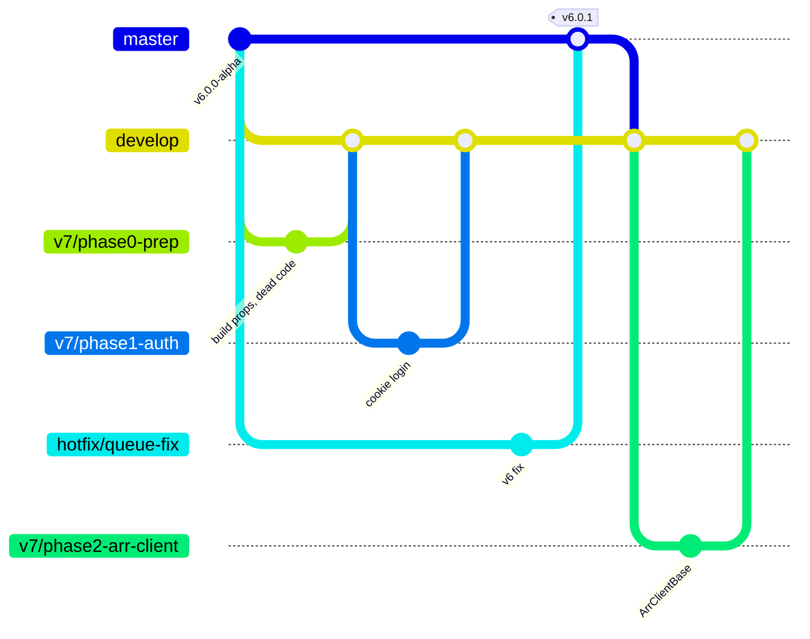
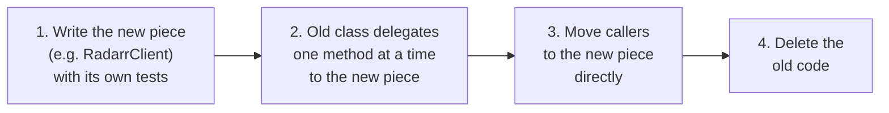
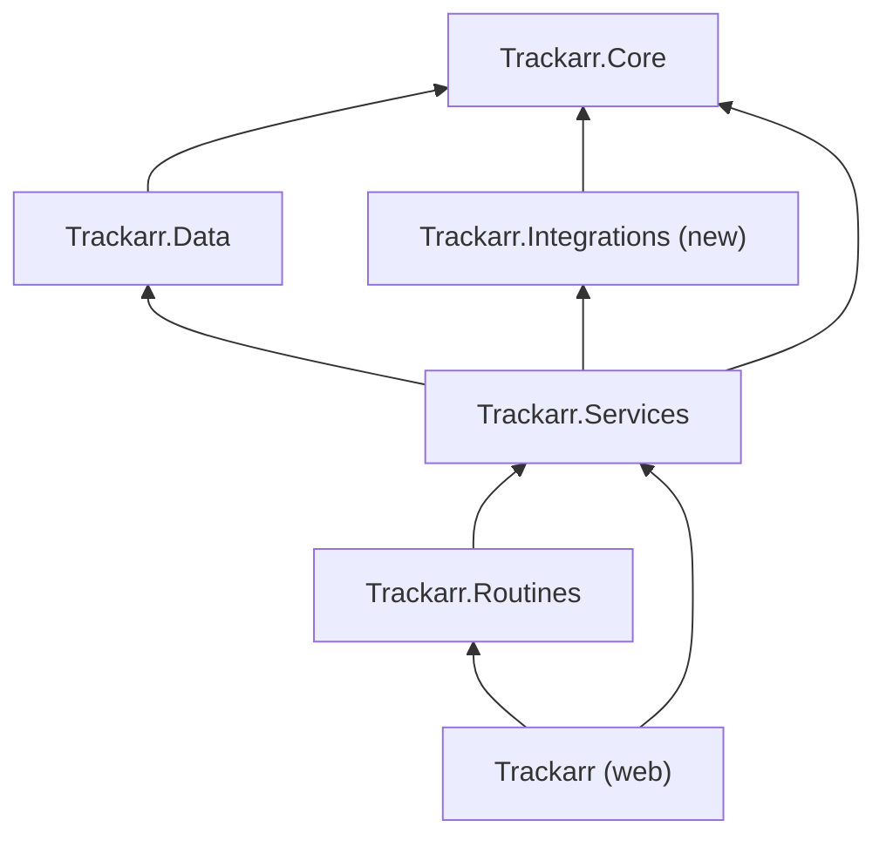
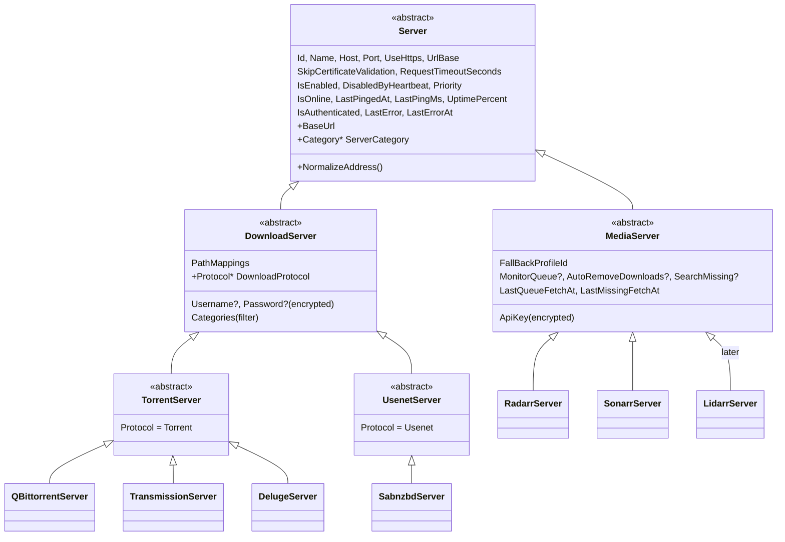
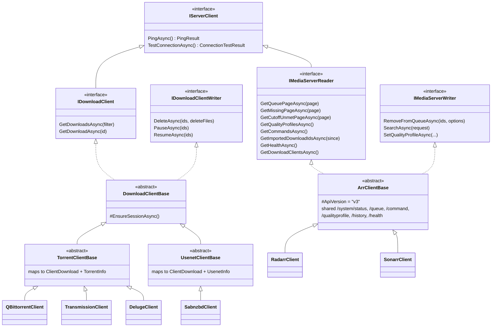
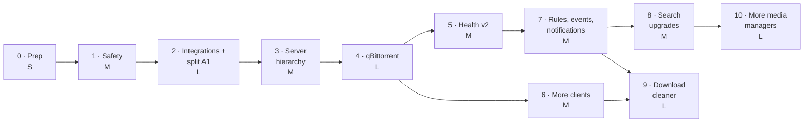

# Trackarr Roadmap: Rebuilding Toward Cleanuparr-Level Features

**Starting point:** 6.0.0-alpha (`feature/configurable-routine-intervals`, commit `a25dcb4`)
**Written:** 2026-11-06
**Companion to:** [AUDIT.md](AUDIT.md). IDs like **S1**, **A1**, **P5** or **F3** refer to findings there.
**Model project:** [Cleanuparr](https://github.com/Cleanuparr/Cleanuparr) v2.10.x, used as a source of ideas.

> **License rule. Read this first.** Cleanuparr is **GPL-3.0** and Trackarr is **MIT**. Use Cleanuparr's *features,
> behaviour, docs and overall structure* as inspiration. **Never copy, translate or closely port its code**, and that
> includes asking an AI to "port this file from Cleanuparr". Doing so would make Trackarr a derivative work that has
> to be released under GPL-3.0. Read their docs to learn *what* to build, then write Trackarr's version from scratch
> without their source open. Every code sketch in this document is original and written for Trackarr.

---

## Contents

1. [Goal and ground rules](#1-goal-and-ground-rules)
2. [Trackarr and Cleanuparr side by side](#2-trackarr-and-cleanuparr-side-by-side)
3. [Rebasing the project: branches and process](#3-rebasing-the-project-branches-and-process)
4. [Target architecture](#4-target-architecture)
5. [Backend phases](#5-backend-phases)
6. [Frontend phases](#6-frontend-phases)
7. [Feature parity checklist](#7-feature-parity-checklist)
8. [Risks](#8-risks)
9. [First week](#9-first-week)
10. [Sources](#10-sources)

---

## 1. Goal and ground rules

### Goal

Trackarr should do what Cleanuparr does: clean the download queue, read the download clients directly, search for
missing items and upgrades, send notifications, and clean up seeding and orphaned downloads. It should do this while
staying its own app, with the parts that make it Trackarr:

- **The health score** (0–100, confidence, recovery credit, restrictions) instead of strikes. This is a deliberate choice.
- **Fallback quality profile with restore**, which Cleanuparr's Seeker doesn't have.
- **Server uptime monitoring**, with heartbeats, uptime history and the *arr apps' own health warnings.
- **The MockServer** safety harness for testing against real data. Since 2026-11-06 it lives in its own repository
  ([alexzeigler/Trackarr.MockServer](https://github.com/alexzeigler/Trackarr.MockServer), private; cloned next to
  this one) with its history kept. MockServer work in this roadmap happens there.

### Decisions already made

| Decision | Consequence |
|----------|-------------|
| Keep the health system | Download-client data feeds **into** the score as new signals. No strike system. |
| Backend first, then frontend | Backend phases ship only the *minimum* UI needed to configure and see a feature, using today's components. The frontend phases restructure and restyle afterwards. |
| Inheritance-based server model | `Server` → `MediaServer` → `RadarrServer`, and `Server` → `DownloadServer` → `TorrentServer` → `QBittorrentServer`. See [4.3](#43-the-entity-hierarchy-what-a-server-is). |
| Keep Blazor Server | See [6.1](#61-keep-blazor-server). |

### Ground rules for every change

1. **Every merge leaves the app runnable and the tests green.** No long-broken branches.
2. **Strangle, don't rewrite.** Add the new abstraction next to the old code, move callers over one at a time, then
   delete the old code ([3.3](#33-the-strangler-pattern)).
3. **v6 databases upgrade automatically.** People are running v6 (about 4,700 Docker pulls). Each migration is tested
   against a copy of a real v6 database.
4. **Every side effect goes through one gate.** Removals, searches, profile changes and client deletions all pass
   through `ActionExecutor`, which is the only place Passive Mode is checked ([4.8](#48-the-action-gate)).
5. **No Cleanuparr code** (see the license rule above).

---

## 2. Trackarr and Cleanuparr side by side

### 2.1 How each one solves the same problems

The "Cleanuparr" column describes their *approach* at the level of ideas, taken from their docs, release notes and folder
layout.

| Area | Trackarr today | Cleanuparr's approach | Change for Trackarr | Phase |
|------|----------------|-----------------------|---------------------|-------|
| **Solution layout** | Core, Data, Services, Routines, web (Blazor) | Domain, Infrastructure, Persistence (plus SQLite and Postgres providers), Api, and an Angular SPA | Add **`Trackarr.Integrations`** for all external HTTP clients, so Services holds orchestration only | 2 |
| **Server model** | One `MediaServer` class plus a `ServiceType` enum, with about 85 `ServiceType.` checks in 28 files | Flat config records (an arr instance; a download-client config with a type field). The *client classes* carry the inheritance | Inheritance on **both** sides: entity classes (EF Core table-per-hierarchy) and client classes, plus a type registry that replaces the `switch` statements | 3 |
| **Arr API access** | The 1,888-line `MediaServerService` does HTTP, caching, persistence and search follow-up (A1) | An arr client interface, an abstract base client, one subclass per arr app, and a factory that picks one by type | `ArrClientBase` → `RadarrClient` / `SonarrClient`, with separate read and write interfaces | 2 |
| **Download clients** | None. Everything comes from the arr queue | A download-service base, a torrent-specific middle layer, and one service per client, with optional *capability interfaces* (seeding cleanup, file blocking, and so on) | `DownloadClientBase` → `TorrentClientBase` → `QBittorrentClient`, with capability interfaces | 4, 6 |
| **Deciding what to remove** | Health score with restrictions (`HealthEvaluator`) | Strike counters per rule (stalled, slow, failed import, metadata), reset on progress | **Keep the health score.** Add client-based signals: real speed, seeds and peers, availability, tracker errors | 5 |
| **Carrying out removals** | Inline `DELETE /queue/{id}` calls from the routine and the UI | Removal requests are queued and handled by a worker | `ActionExecutor` with an action log (also gives the dry-run report, F5) | 1 |
| **Dry run** | Passive Mode, checked in several places | Dry-run mode. One release fixed a bug where dry-run settings leaked into live runs | One gate, so Passive Mode lives in one class with one set of tests | 1 |
| **Missing search** | Throttled batches, backoff, **fallback profile and restore**, abandon and retry | Seeker: missing items, cutoff unmet, custom format score, round robin across instances, one item per run | Keep the engine. Add cutoff unmet, round robin and a daily budget | 8 |
| **Events and notifications** | `DataChangeBus` with no payload (A7). No notifications | Event publisher, with notification consumers for Apprise, Discord, Gotify, Notifiarr, ntfy, Pushover and Telegram | A typed event bus, and notification targets as their own entity hierarchy | 7 |
| **Auth** | None (S1, Critical) | Users, username and password, trusted networks, API key, Plex login, OIDC | Cookie login, "disabled for local addresses", API key. OIDC later | 1 |
| **Secrets** | Plaintext API keys, sent to the browser (S2) | (not checked) | Data Protection value converter. Mask keys in the UI | 1 |
| **HTTP** | Two named `HttpClient`s (strict and insecure TLS) | A dynamic HTTP client system with per-client config and retry settings | Keep named clients, and add `Microsoft.Extensions.Http.Resilience` | 2 |
| **Ignore rules** | Blacklist by indexer or title. Per-download Protect | Ignore by hash, category, tag or tracker | A rules engine that matches category, tag, tracker, indexer or title and can protect, ignore or apply a different policy | 7 |
| **Seeding and orphans** | None | Seeding cleanup by time; orphaned downloads with no hardlinks or no arr reference; unclaimed files moved aside | The same capabilities, built on Trackarr's action gate | 9 |
| **Malware** | None | Community pattern list, plus qBittorrent's own blocking | File-extension check through `ISupportsFileList`, with a configurable list source | 9 |
| **Background jobs** | `RoutineRunner`, one routine at a time (P6) | Separate jobs (queue cleaner, download cleaner, malware blocker, seeker, command monitor) | Per-routine loops, plus new routines for client refresh, cleanup and cutoff search | 2+ |
| **Live UI updates** | Blazor circuit plus a 10-second refresh timer | SignalR hub pushing to the SPA | Typed events let pages refresh only what changed | 7 |
| **Database** | SQLite | SQLite or Postgres | Stay on SQLite | — |

### 2.2 What Trackarr already does better

- **Health scoring with explanations.** Event types, deltas and restrictions show *why* a download is at risk.
  Strikes only say *how many*.
- **Fallback quality profile with restore**, and profile changes that respect edits you made by hand.
- **Episode cascade.** A failing series search splits into per-episode records.
- **Server uptime history** and the *arr apps' own health warnings.
- **Indexer reputation data** (`SourceHealthSummary`) is already collected. Turning it into a page (F6) would be a
  differentiator.
- **MockServer**, a safe proxy over real servers.

---

## 3. Rebasing the project: branches and process

"Rebase" here means rebuilding the project's foundation without breaking what works. It doesn't mean `git rebase`.

### 3.1 Branch layout



| Branch | Purpose | Merges into |
|--------|---------|-------------|
| `master` | Released code. Every release is a `vX.Y.Z` tag here | — |
| `develop` | Integration branch for v7. Always builds, always green | `master`, when you release |
| `v7/<phase>-<topic>` | One focused change, such as `v7/phase2-arr-client` | `develop`, through a PR |
| `hotfix/<topic>` | A fix for v6 users, or CI and docs changes both branches need | `master`, then merge `master` into `develop` |

Versions, tags, Docker images and the release steps are in [RELEASING.md](RELEASING.md).

### 3.2 Setting it up

1. Finish the current branch. Commit `docs/` and the release notes on `feature/configurable-routine-intervals`, open
   a PR into `master`, and merge it.
2. The `v6.0.0-alpha` tag already exists, so v6 is pinned. Update your local `master`:

   ```bash
   git checkout master && git pull
   ```

3. Create the integration branch:

   ```bash
   git checkout -b develop master
   git push -u origin develop
   ```

4. In GitHub, protect `develop`: PRs only, CI must pass. [ci.yml](../.github/workflows/ci.yml) runs the tests on every
   PR into `master` or `develop` and publishes nothing. Only a version tag on `master` publishes an image
   ([release.yml](../.github/workflows/release.yml)), so work on `develop` never reaches people on `latest`.
5. Releases use plain versions (no `-alpha`). v7 is a major version because it changes the database and adds login.
   You decide when `develop` is worth releasing. The first natural point is the end of Phase 4, when qBittorrent
   support lands. Until then, build a `:develop` test image by hand to try it on a real server.

### 3.3 The strangler pattern

This is how to change something big, like `MediaServerService`, without a broken stretch:



Each arrow is one PR or more. At every step the app runs and the existing tests pass.

### 3.4 Safety nets to build before restructuring

| Net | Why | How |
|-----|-----|-----|
| **API fixtures** (T3) | Phase 2 moves every HTTP call. Fixtures prove the parsing didn't change | Hand-written Radarr and Sonarr responses in the v3 shape, in `Trackarr.Tests/Fixtures/{radarr,sonarr}/`, replayed through `FixtureHandler`. *Decided 2026-11-08:* responses recorded from real servers aren't committed. They'd publish library titles, paths and indexer names, and the strangling only needs old and new code to read the same input the same way. Edge cases (season packs, queued items with no size) are written into the fixtures by hand. |
| **A v6 database snapshot** ✅ | Phases 3 and 4 change the schema | `V6DatabaseUpgradeTests` builds the schema exactly as v6.0.0 shipped it from the migrations, puts a row in every table, upgrades to the current schema and checks every row and foreign key survives. No real database is committed, so no personal data ends up in the repository. |
| **Characterization tests** | Pin down today's behaviour where coverage is thin, such as `MissingService` (T1) | Table-driven tests over the state diagram in AUDIT.md 4.4, run before Phase 2 touches the code |
| **Backup before migrate** (F13) ✅ | A failed migration on a user's machine shouldn't lose data | `DatabaseBackup` runs `VACUUM INTO /config/backups/trackarr_pre_<version>_<time>.db` at startup when migrations are pending, and keeps the newest 5. A failed backup is logged and the upgrade goes ahead. |

### 3.5 Definition of done for every PR

- [ ] `dotnet build` with no new warnings, and `dotnet test` green
- [ ] New behaviour has tests: unit tests, fixture-based HTTP tests, or migration tests
- [ ] Run through MockServer against real data when it touches Radarr, Sonarr or a download client
- [ ] Every side effect goes through `ActionExecutor` (from Phase 1 on)
- [ ] AUDIT IDs it closes are listed in the PR description
- [ ] This roadmap is updated if the plan changed

---

## 4. Target architecture

### 4.1 Solution layout

```
Trackarr.Core/            Entities, enums, policies. No ASP.NET or HTTP dependencies (A2).
Trackarr.Data/            AppDbContext, migrations, value converters (secrets).
Trackarr.Integrations/    NEW. Stateless clients for everything outside the app:
  Http/                     HttpClient setup, resilience, auth/session helpers
  Media/                    IMediaServerReader/Writer, ArrClientBase
    Radarr/                 RadarrClient + DTOs
    Sonarr/                 SonarrClient + DTOs
  Downloads/                IDownloadClient, ClientDownload, capability interfaces
    Torrent/                TorrentClientBase
      QBittorrent/          QBittorrentClient + DTOs
      Transmission/
      Deluge/
    Usenet/                 UsenetClientBase
      Sabnzbd/
  Notifications/            INotificationSender + Discord, Apprise, ntfy, ...
  ServerTypes/              The server type registry (descriptors)
Trackarr.Services/        Orchestration: queue sync, health, missing, actions, rules, notifications.
Trackarr.Routines/        Scheduled jobs.
Trackarr/                 Blazor Server UI and host.
Trackarr.Tests/

../Trackarr.MockServer/   Separate repository: the safety proxy, extended with download-client mocks.
```



The key rule: **Integrations never touches the database, and Services never builds an HTTP request.** That is the
split A1 asks for, enforced by the project boundaries.

### 4.2 Two hierarchies: what a server *is*, and how to *talk* to it

| | Entity hierarchy (Core) | Client hierarchy (Integrations) |
|---|---|---|
| Holds | Configuration and status, persisted in SQLite | HTTP logic, no state beyond an auth session |
| Example | `QBittorrentServer`: host, port, username, encrypted password, uptime | `QBittorrentClient`: login, list torrents, delete, tag |
| Lifetime | Loaded per operation through `IDbContextFactory` | Created per server by `IServerClientFactory` |
| Inheritance | `Server` → `DownloadServer` → `TorrentServer` → `QBittorrentServer` | `DownloadClientBase` → `TorrentClientBase` → `QBittorrentClient` |

Cleanuparr keeps its config records flat and puts inheritance only on the client side. Trackarr puts inheritance on both
sides, as you want. That works well with EF Core's table-per-hierarchy (TPH) mapping, and it lets each server type carry
its own properties and behaviour.

### 4.3 The entity hierarchy: what a server is



About the name "BittorrentServer": put a **protocol layer** (`TorrentServer` and `UsenetServer`) between
`DownloadServer` and the concrete clients. Seeding rules, trackers and the private flag apply to *every* torrent
client, so they go on `TorrentServer` once. qBittorrent, Transmission and Deluge then inherit them.

#### C# sketch

```csharp
// Trackarr.Core/Server/Server.cs
public enum ServerCategory { Media, Download }

public abstract class Server
{
    public int Id { get; set; }
    public string Name { get; set; } = string.Empty;

    // Connection
    public string Host { get; set; } = string.Empty;
    public int Port { get; set; }
    public bool UseHttps { get; set; }
    public string? UrlBase { get; set; }
    public bool SkipCertificateValidation { get; set; }
    public int? RequestTimeoutSeconds { get; set; }

    // Lifecycle
    public DateTime CreatedAt { get; set; } = DateTime.UtcNow;
    public bool IsEnabled { get; set; } = true;
    public bool DisabledByHeartbeat { get; set; }
    public int Priority { get; set; }

    // Routine-owned status (written by the heartbeat)
    public bool IsOnline { get; set; }
    public DateTime? LastPingedAt { get; set; }
    public long? LastPingMs { get; set; }
    public double UptimePercent { get; set; } = 100;
    public bool IsAuthenticated { get; set; }
    public DateTime? LastErrorAt { get; set; }
    public string? LastError { get; set; }

    public abstract ServerCategory Category { get; }

    public string BaseUrl => $"{(UseHttps ? "https" : "http")}://{Host}:{Port}{NormalizePath(UrlBase)}";
    public void NormalizeAddress() { /* moved unchanged from MediaServer */ }
    protected static string NormalizePath(string? path) { /* moved unchanged */ }
}

// Trackarr.Core/Server/Media/MediaServer.cs
public abstract class MediaServer : Server
{
    public override ServerCategory Category => ServerCategory.Media;

    public string? ApiKey { get; set; }              // encrypted at rest (Phase 1)
    public int? FallBackProfileId { get; set; }
    public QualityProfile? FallbackProfile { get; set; }
    public ServerMetadata? Metadata { get; set; }

    public bool? MonitorQueue { get; set; }
    public bool? AutoRemoveDownloads { get; set; }
    public bool? SearchMissing { get; set; }

    public DateTime LastQueueFetchAt { get; set; }
    public int? LastQueueCount { get; set; }
    public DateTime? LastMissingFetchAt { get; set; }
    public int? LastMissingCount { get; set; }
}

public sealed class RadarrServer : MediaServer { }
public sealed class SonarrServer : MediaServer
{
    // Sonarr-only settings live here when they appear, e.g. a per-server episode-cascade limit.
}

// Trackarr.Core/Server/Downloads/DownloadServer.cs
public enum DownloadProtocol { Torrent, Usenet }

public abstract class DownloadServer : Server
{
    public override ServerCategory Category => ServerCategory.Download;
    public abstract DownloadProtocol Protocol { get; }

    public string? Username { get; set; }
    public string? Password { get; set; }            // encrypted at rest
    public string? ApiKey { get; set; }              // SABnzbd, and newer qBittorrent versions
    public string? CategoriesJson { get; set; }      // only manage these categories (null = all)
    public string? PathMappingsJson { get; set; }    // client path -> Trackarr path (Phase 9)
}

public abstract class TorrentServer : DownloadServer
{
    public override DownloadProtocol Protocol => DownloadProtocol.Torrent;
}

public abstract class UsenetServer : DownloadServer
{
    public override DownloadProtocol Protocol => DownloadProtocol.Usenet;
}

public sealed class QBittorrentServer : TorrentServer { }
public sealed class TransmissionServer : TorrentServer { public string RpcPath { get; set; } = "/transmission/rpc"; }
public sealed class DelugeServer : TorrentServer { }        // password only, no username
public sealed class SabnzbdServer : UsenetServer { }        // API key only
```

#### EF Core mapping: one `Servers` table (TPH)

```csharp
modelBuilder.Entity<Server>(e =>
{
    e.ToTable("Servers");
    e.HasKey(s => s.Id);
    e.HasDiscriminator<string>("Kind")
        .HasValue<RadarrServer>("Radarr")
        .HasValue<SonarrServer>("Sonarr")
        .HasValue<QBittorrentServer>("QBittorrent")
        .HasValue<TransmissionServer>("Transmission")
        .HasValue<DelugeServer>("Deluge")
        .HasValue<SabnzbdServer>("Sabnzbd");
    e.Property("Kind").HasMaxLength(50);
    // ...shared column config moved from the old MediaServer block
});

modelBuilder.Entity<MediaServer>(e =>
{
    e.HasOne(s => s.Metadata).WithOne().HasForeignKey<ServerMetadata>(m => m.ServerId)
        .OnDelete(DeleteBehavior.Cascade);
    e.HasOne(s => s.FallbackProfile).WithMany().HasForeignKey(s => s.FallBackProfileId)
        .OnDelete(DeleteBehavior.Restrict);
});
```

**Why TPH, one table:**

- `ServerStatusSamples` and `ServerHealthEvents` already point at a server ID. With one table they keep working for
  download clients too, so **uptime monitoring for qBittorrent comes free**.
- No joins. Every server query is one table scan of a handful of rows.
- The migration from v6 is almost free. The existing `ServiceType` column already holds `"Radarr"` and `"Sonarr"` as
  strings, which are exactly the discriminator values. The migration is:

  ```csharp
  migrationBuilder.RenameTable(name: "MediaServers", newName: "Servers");
  migrationBuilder.RenameColumn(table: "Servers", name: "ServiceType", newName: "Kind");
  migrationBuilder.AddColumn<string>(name: "Username", table: "Servers", nullable: true);
  migrationBuilder.AddColumn<string>(name: "Password", table: "Servers", nullable: true);
  // ...the other download-server columns, all nullable
  ```

  SQLite rebuilds tables for renames that involve foreign keys. EF Core handles that, and the v6 snapshot test
  ([3.4](#34-safety-nets-to-build-before-restructuring)) proves it.

**The cost:** download-only columns are null on media rows and the reverse, and the database can't stop
`DownloadAttempts.ServerId` from pointing at a qBittorrent row. Enforce that in code with typed navigations
(`DownloadAttempt.Server` is a `MediaServer`) and the typed repository methods below.

**Rejected alternative:** table-per-type (TPT) would put every server query behind a join and complicate the migration,
for no real gain at this table size.

#### Replacing `ServiceType` checks

There are about **85 `ServiceType.` references in 28 files**, about half of them in tests. They go away in three ways:

| Today | After |
|-------|-------|
| `if (server.ServiceType == ServiceType.Sonarr)` in services | Polymorphism in the client (`SonarrClient` overrides the search), or `server is SonarrServer s` |
| `switch` for icons, default ports, display names (`Utils`, `AddServerModal`) | The server type registry ([4.4](#44-the-server-type-registry)) |
| `new MediaServer { ServiceType = ServiceType.Radarr }` in tests | `new RadarrServer { ... }`, or a `TestServers.Radarr()` builder |

### 4.4 The server type registry

One descriptor per concrete type means adding a type never touches a `switch`:

```csharp
// Trackarr.Integrations/ServerTypes/IServerType.cs
[Flags]
public enum ServerCapabilities
{
    None = 0,
    Queue = 1, MissingSearch = 2, CutoffSearch = 4, QualityProfiles = 8,     // media
    Tags = 16, Categories = 32, FileList = 64, SeedingInfo = 128,            // download
}

public interface IServerType
{
    string Kind { get; }                    // "QBittorrent". Matches the EF discriminator value
    string DisplayName { get; }             // "qBittorrent"
    ServerCategory Category { get; }
    int DefaultPort { get; }                // 8080
    string Icon { get; }                    // Tabler icon name
    ServerCapabilities Capabilities { get; }
    Server CreateNew();                     // new QBittorrentServer { Port = 8080 }
    Type ClientType { get; }                // typeof(QBittorrentClient)
}
```

Register each one with `services.AddSingleton<IServerType, QBittorrentServerType>()`. The UI's "Add server" picker
lists `IEnumerable<IServerType>`, grouped by category.

**Adding a new type** means one entity class, one descriptor, one client class, fixtures, and one `HasValue<>` line.

### 4.5 The client hierarchy: how to talk to a server



**Separate read and write interfaces.** Only `ActionExecutor` is given the `*Writer` interfaces. Everything else gets
readers. That way the compiler enforces ground rule 4: a routine *can't* delete something without going through the gate.

**Capability interfaces** handle features that only some clients have. Code checks for them at runtime:

```csharp
public interface ISupportsTags      { Task AddTagsAsync(IEnumerable<string> ids, IEnumerable<string> tags, CancellationToken ct); }
public interface ISupportsFileList  { Task<IReadOnlyList<ClientFile>> GetFilesAsync(string id, CancellationToken ct); }
public interface ISupportsSeedingInfo { /* ratio, seeding time, trackers: torrent clients */ }

if (client is ISupportsFileList files) { /* malware check */ }
```

**Session handling** belongs in `DownloadClientBase.EnsureSessionAsync()`, which each client overrides:

| Client | Session model |
|--------|---------------|
| qBittorrent | `POST /api/v2/auth/login` returns an `SID` cookie. Send it as a `Cookie` header that you manage yourself, so `IHttpClientFactory` can still pool handlers (a shared `CookieContainer` would leak sessions between servers). Newer versions accept an API key. Check `/api/v2/app/webapiVersion`. |
| Transmission | The first call returns **409** with `X-Transmission-Session-Id`. Retry with that header. Basic auth if configured. |
| Deluge | JSON-RPC on `/json`: `auth.login(password)`, then check `web.connected` and connect to a daemon host if needed. |
| SABnzbd | Stateless. `apikey=` on every `/api?mode=…&output=json` call. |
| Radarr/Sonarr | Stateless. `X-Api-Key` header (as today). |

**The factory:**

```csharp
public interface IServerClientFactory
{
    IMediaServerReader Reader(MediaServer server);
    IDownloadClient Reader(DownloadServer server);
    // Writers are only resolvable by ActionExecutor (internal registration or a separate interface).
}
```

Cache client instances per `(server.Id, configuration version)` so qBittorrent sessions are reused, and drop the cache
entry when the server is edited.

### 4.6 The normalized download model

Every download client maps its own format into one shape, which the health system and UI read:

```csharp
public enum ClientDownloadState
{
    Queued, Downloading, Stalled, FetchingMetadata, Paused, Checking, Moving,
    Seeding, Completed, Error, Unknown
}

public sealed record ClientDownload
{
    public required string Id { get; init; }          // torrent info-hash, or SABnzbd nzo_id
    public required string Name { get; init; }
    public ClientDownloadState State { get; init; }
    public double Progress { get; init; }             // 0..1
    public long Size { get; init; }
    public long SizeLeft { get; init; }
    public long DownloadSpeed { get; init; }          // bytes/s, as reported by the client
    public long UploadSpeed { get; init; }
    public TimeSpan? Eta { get; init; }
    public string? Category { get; init; }
    public IReadOnlyList<string> Tags { get; init; } = [];
    public string? SavePath { get; init; }
    public DateTime? AddedAt { get; init; }
    public string? ErrorMessage { get; init; }
    public TorrentInfo? Torrent { get; init; }        // null for usenet
    public UsenetInfo? Usenet { get; init; }          // null for torrents
}

public sealed record TorrentInfo(
    int Seeds, int Peers, double Availability, double Ratio, TimeSpan SeedingTime,
    bool IsPrivate, bool HasMetadata, IReadOnlyList<TrackerStatus> Trackers);

public sealed record UsenetInfo(string? FailureMessage, bool IsRepairing, bool IsExtracting);
```

**Linking a queue row to a client download.** The *arr queue's `downloadId` is the torrent info-hash (uppercase) for
torrent clients and the `nzo_id` for SABnzbd. Matching:

1. Compare `DownloadItem.DownloadId` to `ClientDownload.Id` without regard to case, across the download servers with the
   matching protocol.
2. Store the match on the attempt (`DownloadAttempt.DownloadServerId`, nullable, `SetNull` on delete), so later scans
   go straight to the right client.
3. Show unmatched rows as "client not configured" instead of guessing.

**Shortcut for setup:** `GET /api/v3/downloadclient` on Radarr and Sonarr lists the clients they use, with host, port
and category. Offer "Import from Radarr" to pre-fill the form. Passwords come back masked, so the user types them in.

### 4.7 Services after the `MediaServerService` split (A1)

| New service | Takes over | Notes |
|-------------|-----------|-------|
| `ServerRepository` | Server CRUD, status writes | Status updates use `ExecuteUpdateAsync` on changed columns (P9). Typed getters: `GetMediaServersAsync()`, `GetDownloadServersAsync()`. |
| `MediaRepository` | Movie, Series and Episode upserts, `MediaRecordMappers` | |
| `QueueSyncService` | Queue fetch, the `DownloadQueue` mirror, scoring new items | Per-server lock becomes an injected singleton (A5). Also fetches client downloads from Phase 4 on. |
| `DownloadClientSyncService` | (new) | Fetches each download server's items into a `ClientDownloads` mirror table. |
| `SearchCommandService` | `Trigger*SearchAsync`, `GetActiveSearchesAsync` | The fire-and-forget follow-up becomes a hosted `CommandWatcher` with a shutdown token (P12). |
| `ActionExecutor` | Every mutating call | See [4.8](#48-the-action-gate). |
| `MediaSummaryService` | The four `MediaHealthSummary` writers | One owner (A10). |
| `QueueQueryService`, `MissingQueryService`, `RoutineQueryService` | EF queries now inside pages | Pages stop injecting `IDbContextFactory` (A6) and stop calling APIs (P5). |

### 4.8 The action gate

All side effects become small action records that go through one executor:

```csharp
public abstract record ServerAction(int ServerId, string Reason, string Source);   // Source: "routine:queue-evaluation", "user"

public sealed record RemoveQueueItems(int ServerId, IReadOnlyList<int> QueueIds, bool Blocklist,
    bool RemoveFromClient, bool SearchAgain, string Reason, string Source) : ServerAction(ServerId, Reason, Source);
public sealed record TriggerSearch(int ServerId, SearchRequest Request, string Reason, string Source)
    : ServerAction(ServerId, Reason, Source);
public sealed record ChangeQualityProfile(int ServerId, int RemoteItemId, int ProfileId, int? OnlyIfCurrent,
    string Reason, string Source) : ServerAction(ServerId, Reason, Source);
public sealed record DeleteClientDownloads(int ServerId, IReadOnlyList<string> Ids, bool DeleteFiles,
    string Reason, string Source) : ServerAction(ServerId, Reason, Source);

public enum ActionOutcome { Executed, Simulated, Skipped, Failed }

public interface IActionExecutor
{
    Task<ActionOutcome> ExecuteAsync(ServerAction action, CancellationToken ct);
}
```

The executor:

1. Checks Passive Mode (global and per server). If it's on, the outcome is **Simulated** and nothing is sent.
2. Checks protection rules one last time.
3. Calls the writer interface.
4. Writes an `ActionLog` row (action, server, target, reason, source, outcome, error) and publishes a typed event.

What this gives you:

- **Passive Mode is one `if` in one class**, with one test file. The bug class where dry-run settings leak into live
  runs can't happen.
- The **dry-run report** (F5) is just the `ActionLog` filtered to `Simulated`.
- **Notifications** subscribe to the events the executor publishes.
- Group removal deduplicates by download ID in one place (B11).

### 4.9 Health system v2: keep it, feed it better data

The score stays. Download-client data becomes a **new, optional input**.

```csharp
public static HealthObservation BuildObservation(
    DownloadItem item, ClientDownload? client, DownloadAttempt attempt, HealthSnapshot snapshot, DateTime now)
```

**When `client` is null, behaviour is exactly what it is today.** That keeps the roughly 150 evaluator tests valid
without any edits, and Trackarr keeps working for users who never add a download client.

| Client signal | Observation flag | Today |
|---------------|-----------------|-------|
| `DownloadSpeed > 0` | `HasPositiveSpeed` (exists) | Inferred from `SizeLeft` changes between scans |
| `Seeds == 0 && Peers == 0` | `IsStalledNoConnections` (exists) | Guessed from the arr status message |
| `State == FetchingMetadata` for longer than X minutes | `IsFetchingMetadata` (exists) plus a duration | One scan's status |
| `Availability < 1` for N scans | **New:** `IsUnavailable`, a penalty | Not detected |
| Speed under `MinSpeed` or ETA over `MaxEta` | **New:** `IsSlow`, a mild penalty | Not detected |
| Every tracker reports an error | **New:** `HasTrackerError` | Not detected |
| Client error state | `HasError` (exists), now with the client's message | Arr status message only |
| `Paused`, `Queued`, `Checking`, `Moving` | Scoring exemption (exists) | Partly detected |
| SABnzbd failure (missing articles, repair failed) | `HasError` plus a specific `ErrorKey` | Arr message only |

**Private trackers.** Removing a private torrent from the client before its seeding requirement is met can lead to a
hit-and-run warning on that tracker. Add a policy choice for private torrents: *remove from the arr only (keep
seeding)*, *skip removal*, or *treat normally*. Default to the first.

**Score saturation (A11).** The audit noted that the score is pinned at −100 within about four bad scans, after which
the counters decide removal. Since you're keeping the health model, consider making the score stay informative later on
(cap streak growth, or use an exponentially weighted average) behind a policy version setting. This isn't needed for
feature parity.

### 4.10 Events and notifications

**Typed events** replace the payload-free `DataChangeBus` (A7):

```csharp
public interface IAppEvent { DateTime OccurredAt { get; } }
public sealed record DownloadFlagged(int AttemptId, int ServerId, string Title, int Score, string Reason) : IAppEvent { ... }
public sealed record ActionCompleted(ServerAction Action, ActionOutcome Outcome) : IAppEvent { ... }
public sealed record ServerWentDown(int ServerId, string Message) : IAppEvent { ... }
public sealed record ServerRecovered(int ServerId) : IAppEvent { ... }
public sealed record MissingItemAbandoned(int ServerId, string Title) : IAppEvent { ... }
public sealed record ProfileLowered(int ServerId, string Title, string From, string To) : IAppEvent { ... }

public interface IEventBus
{
    void Publish<T>(T e) where T : IAppEvent;
    IDisposable Subscribe<T>(Func<T, CancellationToken, Task> handler) where T : IAppEvent;
}
```

Subscribers include the UI refresher (pages refresh only on relevant events, P4), the `NotificationDispatcher` and the
History page's activity feed.

**Notification targets follow the same inheritance pattern as servers**, stored TPH in a `NotificationTargets` table:

```
NotificationTarget (abstract: Name, IsEnabled, which events to send)
├── DiscordTarget     (WebhookUrl)
├── AppriseTarget     (Url, Tags)       <- one integration that reaches dozens of services
├── NtfyTarget        (ServerUrl, Topic, Token)
├── GotifyTarget      (ServerUrl, AppToken)
├── PushoverTarget    (UserKey, AppToken)
└── TelegramTarget    (BotToken, ChatId)
```

with `INotificationSender<TTarget>` implementations in Integrations. Start with **Discord, Apprise and ntfy**.

### 4.11 Authentication (S1) on Blazor Server

| Piece | Approach |
|-------|----------|
| Users | One `Users` table. Start with a single admin. Hash passwords with `PasswordHasher<T>`. |
| First run | If no user exists, every route redirects to `/setup`, which creates one. |
| Login page | **Must be static server rendering**, because a cookie can't be set from an interactive circuit. Mark `Login.razor` and `Setup.razor` with `[ExcludeFromInteractiveRouting]`. In `App.razor`, replace the fixed `<Routes @rendermode="new InteractiveServerRenderMode(false)"/>` with a render mode chosen by `HttpContext.AcceptsInteractiveRouting()`, so those pages render statically and the rest stay interactive. The form posts and the endpoint calls `SignInAsync`. |
| Cookie | `AddAuthentication().AddCookie()`, sliding expiry, `SameSite=Lax`, `Secure` when HTTPS. Works with the URL base (`PathBase`). |
| Local bypass | Auth method setting: *Forms* or *Disabled for local addresses*. Reuse `HostingOptions.ParseTrustedProxies`-style ranges for "local". Implement it as a small authentication handler that signs in a synthetic local user. **Built** as `LocalAccess` plus a middleware after `UseAuthentication`: a request is local only when its address is in the ranges *and* no proxy header is left that the forwarded-headers step didn't handle. |
| API key | A second handler for `/api/*` and webhooks, using an `X-Api-Key` header. Generate the key on first run and show it in Settings. |
| UI | `AuthorizeRouteView` in `Routes.razor`, `[Authorize]` by default, and a logout item in the settings dropdown. |
| Locked out | An environment variable (`TRACKARR_RESET_AUTH=true`) clears the user on next start, like the *arr apps' config edit. |
| Later | OIDC (`AddOpenIdConnect`) for Authelia, Authentik and others. |

### 4.12 Secrets at rest (S2)

```csharp
public sealed class ProtectedStringConverter(IDataProtector protector)
    : ValueConverter<string?, string?>(
        v => v == null ? null : protector.Protect(v),
        v => v == null ? null : protector.Unprotect(v));
```

- `AppDbContext` receives `IDataProtectionProvider` and applies the converter to every secret column: media server
  `ApiKey`, download server `Password` and `ApiKey`, notification tokens, and proxy credentials.
- **One-time upgrade:** on startup, find values that aren't protected yet (`Unprotect` throws) and re-save them
  encrypted. Test this against the v6 snapshot.
- **Never send a secret to the browser.** Forms show `••••1a2b` and a "Replace" field. An empty field means "keep the
  current value".
- The Data Protection keys already live in `/config/keys`. Document that a backup must include that folder, or the
  secrets can't be read. (Done in the README's "Backups" section.)

### 4.13 Typed settings (A4)

Each new client type and rule adds settings, and today's string keys already scatter defaults across four places. Do the
backend half early, in Phase 2:

- One options class per category (`GeneralOptions`, `HealthPolicyOptions`, `MissingPolicyOptions`,
  `DownloadCleanerOptions`…), defaults defined once in the class, validated with DataAnnotations.
- Stored as today's key/value rows (with `InvariantCulture`, which fixes B3) or one JSON row per category.
- Exposed through `IOptionsMonitor<T>`-style access, so `HealthPolicy` stops being rebuilt on every call.
- The settings pages bind to the options object in the frontend phase.

### 4.14 Routines

- Run each routine on its own loop, so a long missing scan no longer delays heartbeats (P6). Fix the manual queue race
  (B4) at the same time.
- **New routines** (kebab-case keys): `download-client-refresh`, `cutoff-search` (or a mode of `missing_search`),
  `seeding-cleanup`, `orphan-scan`, `notification-digest`.
- The heartbeat pings **every** `Server` through `IServerClient.PingAsync`, so download clients get uptime tracking with
  no extra code. Require N consecutive failures before disabling (B13).

---

## 5. Backend phases

Each phase lists its goal, steps, the files it touches, how you know it's done, and the AUDIT IDs it closes. Effort is
**S** (days), **M** (1–2 weeks) or **L** (several weeks) of evening and weekend work.



Phases 5 and 6 can run in either order once Phase 4 lands.

### Phase 0: Prep (S)

**Goal:** a clean base, with less code to move later. No behaviour change.

1. Set up branches as in [3.2](#32-setting-it-up).
2. Add `Directory.Build.props` with `TargetFramework`, `Nullable`, `ImplicitUsings`, `AnalysisLevel` and
   `TreatWarningsAsErrors` for Release (A14). Remove the duplicates from the six csproj files.
3. Delete dead code (A9): the `Trackarr.Client/` folder, `QueueStatus`, `DownloadItemTrackingState`, `Option`,
   `StaticRegion`, `Tasks.razor`, `System.razor`, the empty scaffolds, unused enum values, `MediaServer.IsDefault` and
   `DownloadsProcessed`. Anything deleted now doesn't have to be ported in Phase 3. `AttemptStatus.Replaced` stays:
   the replacement counters on the media details modal read it, so Phase 5 decides whether to implement or remove it.
4. Remove ASP.NET from Core (A2): move `ChartHost` to the web project and `StatusMessageDecode` to
   `Trackarr.Services` (returning a string, so the tests can still reach it), and move `[NotMapped]`/`[ForeignKey]`
   configuration into `AppDbContext`. **This is required:** `Trackarr.Integrations` will reference Core, and Core must
   stay dependency-free. Its only package is `Microsoft.Extensions.Logging.Abstractions`, for `LogLevel`.
5. Build the safety nets from [3.4](#34-safety-nets-to-build-before-restructuring): API fixtures (hand-written, not
   recorded; see the T3 row), the v6 database snapshot test, and backup-before-migrate.

**Done when:** build and tests are green, the fixtures are checked in, and the v6 snapshot migrates in a test.

### Phase 1: Safety (M)

**Goal:** safe to expose, and every side effect goes through one gate. This comes before download clients because
they add *more* secrets and *more* destructive actions.

1. **Auth** as in [4.11](#411-authentication-s1-on-blazor-server). Add a minimal Login, Setup and Settings > Security
   page using the existing layout. Forms login lands first (`v7/phase1-auth`). "Disabled for local addresses" follows in
   its own PR (`v7/phase1-local-access`), because it needs care behind reverse proxies: any proxy header the
   forwarded-headers step didn't handle means "not local" (the CVE-2026-30975 class). The API key waits until there's
   an `/api` to protect.
2. **Secrets** as in [4.12](#412-secrets-at-rest-s2), with masking in `AddServerModal`. Built in `v7/phase1-secrets`:
   `SecretProtector` (values marked `dp1:`, so plain v6 values are recognised without relying on exceptions), a
   `ProtectedDbContextFactory` that hands it to every context, `SecretUpgrade` at startup (then `VACUUM`, because
   SQLite keeps overwritten values in free pages), and the proxy password as its own encrypted setting.
3. **`ActionExecutor` and `ActionLog`** ([4.8](#48-the-action-gate)). Route the existing calls through it:
   - `QueueEvaluationRoutine`: blacklist removal and health removal
   - `Queue.razor.cs`: user Remove, deduplicated by download ID (B11)
   - `MissingService`: search pushes, fallback profile changes and profile restore
   - `Missing.razor.cs`: Force Search (B17)

   After this step, Passive Mode is **enforced** only in `ActionExecutor`. Today `IsPassiveMode` is checked in
   `QueueEvaluationRoutine`, `HealthService`, `MissingService`, `ServerSyncService` and `HealthEvaluator`. Delete the
   enforcing checks. Keep the one in `HealthEvaluator.BuildDecision` as a display-only restriction, so the Queue page
   can still say *why* a download won't be removed.

   Built in `v7/phase1-actions`. The writers on `MediaServerService` are `internal`, so the gate is enforced by the
   compiler, and `ActionExecutorTests.PassiveMode_IsOnlyEnforcedByTheGate` scans the source for anything else reading
   Passive Mode. Decisions made along the way:
   - Passive Mode applies to **automatic** actions only (`ActionSource` other than `user`). What you click still
     happens, as the setting's tooltip always said for removals.
   - The display restriction lives in `HealthService` (not `HealthEvaluator`), and sets
     `HealthDecision.BlockedByPassiveMode`, so health removals still reach the gate and show up as simulated.
   - A simulated action that repeats within 24 hours updates one `ActionLog` row (`Count`, `LastOccurredAt`).
   - The gate also re-checks protection before an automatic removal. The blacklist path never did.
   - No typed event yet: the gate calls `DataChangeBus.NotifyChanged()`. Typed events come with Phase 7.
   - The UI is **System > Actions**, with a filter by outcome. Filtered to Simulated, it's the F5 dry-run report
     (the daily summary waits for notifications).
4. **Fix the bugs that get worse with more servers:** B3 (culture), B4 (runner queue), B13 (heartbeat threshold), and
   B9 (`async void`). Built in `v7/phase1-bugfixes`. CA1304/1305/1310/1311 are now errors in Release builds. The
   heartbeat disables a server after `HeartbeatRoutine.FailuresBeforeDisable` (3) failures in a row, counted from the
   status samples. Still to add: dedicated tests for B3's comma and U+2212 values, and for B4's concurrent queueing.

**Done when:** a login is required, keys are encrypted and masked, a test proves Passive Mode never reaches a writer,
and `IsPassiveMode` is only read by `ActionExecutor`, `SettingsService`, the UI and the evaluator's display restriction.
**Closes:** S1, S2, S3 (partly), B3, B4, B9, B11, B13, B17.

### Phase 2: Integrations project and the `MediaServerService` split (L)

**Goal:** HTTP lives in `Trackarr.Integrations`, orchestration lives in Services, and `MediaServerService` is gone.

1. Create `Trackarr.Integrations` (references Core only) and add `Microsoft.Extensions.Http.Resilience` to
   `Directory.Packages.props`.
2. **Move the DTOs** out of Core into `Integrations/Media/Arr/Dtos`: `QueueRecord`, `QueueResponse`, `MovieRecord`,
   `SeriesRecord`, `EpisodeRecord`, `MissingEpisodeRecord`, `MissingMovieResponse`, `MissingShowResponse`,
   `CommandRecord`, `HistoryResponse` and `RemoteHealthMessage`. Give `QualityProfile`, `ServerMetadata`, `Episode` and
   `DownloadItem` their own DTOs and mappers, so entities stop carrying `[JsonPropertyName]` (A3).
3. **Write `IMediaServerReader`, `IMediaServerWriter`, `ArrClientBase`, `RadarrClient` and `SonarrClient`**, tested
   against the Phase 0 fixtures. At this stage they still take today's `MediaServer` entity. Phase 3 changes that.

   Steps 1 and 3, and the DTO move in step 2, are built in `v7/phase2-integrations`. Decisions made along the way:
   - **The clients return the types `MediaServerService` parses today** (`QualityProfile`, `ServerMetadata`, the
     records), so the strangling in step 4 can't change what Trackarr reads. The entity DTOs and mappers (A3) land in
     step 4, when the entities stop being parsed directly.
   - **`Microsoft.Extensions.Http.Resilience` waits for step 4**, where the clients are first used. Its retries must
     be limited to GET: retrying a DELETE or a search command could repeat an action.
   - **Hand-written fixtures, no recordings** (see the T3 row in 3.4). Each strangling PR feeds the old and new code
     the same fixtures and checks they agree, adding edge cases to the fixtures as it goes.
   - The planned PRs from here: strangle the reads (status, health, profiles, commands, history), then missing
     media, then the queue and writes; split what's left (4.7) with a `CommandWatcher`; pages stop calling the
     *arr apps; typed settings; per-routine loops; delete `MediaServerService`.
4. **Strangle `MediaServerService`** method by method ([3.3](#33-the-strangler-pattern)). Its HTTP code becomes calls to
   the reader or writer. Suggested order, from easiest to riskiest: system status and health, quality profiles,
   commands and history, missing pages, then the queue.

   Part 1 is built in `v7/phase2-strangle-reads`. The connection test, system status, health, quality profiles,
   active searches, the search follow-up, import history and the three writes (queue removal, profile change,
   searches) now go through the clients. `MediaServerServiceReadTests` pinned their results before the move and
   still pass after it. `QualityProfile` lost its JSON attributes: the client reads a `QualityProfileDto` (A3).

   Part 2 is built in `v7/phase2-strangle-media`. The missing movie and episode pages, the single movie and series
   fetches, and a series' episode list (sync and states) now go through `RadarrClient` and `SonarrClient`, pinned the
   same way.

   Part 3 is built in `v7/phase2-strangle-queue`. The queue pages go through the clients too, and the queue record to
   `DownloadItem` mapping moved into `MediaRecordMappers`. `MediaServerService` makes no HTTP calls of its own any
   more: its `CreateClient` is gone. Next: `Microsoft.Extensions.Http.Resilience` on the clients, retrying GETs only.
5. **Split what's left** into the services in [4.7](#47-services-after-the-mediaserverservice-split-a1). Replace
   `FollowSearchAsync` with a hosted `CommandWatcher` (P12), and move the static dictionaries (`ProfileFetchTimes`,
   `QueueLocks`) into injected singletons (A5).
6. **Pages stop calling the *arr apps** (P5). The Queue page reads `QueueQueryService`, and its Refresh button enqueues
   `queue_refresh`. The details modal reads local data and gets an explicit "Sync from Sonarr" button. Inject query
   services instead of `IDbContextFactory` in `Missing` and `Routines` (A6).
7. **Typed settings, backend half** ([4.13](#413-typed-settings-a4)).
8. **Per-routine loops** ([4.14](#414-routines), P6).
9. Delete `MediaServerService.cs`.

**Done when:** `MediaServerService` no longer exists, no Services class is over about 500 lines, opening a page never
sends an HTTP request, and every fixture test passes.
**Closes:** A1, A3, A4 (backend), A5 (partly), A6, A10, P5, P6, P12, T3.

### Phase 3: The server hierarchy (M)

**Goal:** `Server` → `MediaServer` → `RadarrServer`/`SonarrServer` in code and in the database, and `ServiceType`
deleted.

1. Add `Server`, make `MediaServer` abstract, and add `RadarrServer` and `SonarrServer`
   ([4.3](#43-the-entity-hierarchy-what-a-server-is)). Move the shared properties up into `Server`.
2. Map TPH and write the migration (rename `MediaServers` → `Servers` and `ServiceType` → `Kind`). Run it against the
   v6 snapshot in a test. The backup-before-migrate from Phase 0 protects real users.
3. Add the **server type registry** ([4.4](#44-the-server-type-registry)) for Radarr and Sonarr.
4. Replace the `ServiceType` checks, working outward: Integrations (choose the client by type), Services (`MissingService`
   has 4, `HistoryService` 2, `HealthRepository` 2), Routines, tests (use a `TestServers` builder), and finally the UI
   (`Utils` icons, `AddServerModal` and `Servers` read from the registry).
5. `IServerClientFactory` resolves the client from the entity's type.
6. Generalize the heartbeat, uptime samples and server health events to `Server`.
7. Delete the `ServiceType` enum.

**Done when:** `grep -r "ServiceType"` finds only migrations, and adding a fictional `TestarrServer` in a test needs
only new files plus one `HasValue<>` line.

### Phase 4: Download clients, starting with qBittorrent (L)

**Goal:** Trackarr reads qBittorrent and shows its data for each queue item. **No scoring changes yet.**

1. **Entities:** `DownloadServer`, `TorrentServer`, `UsenetServer` (empty for now) and `QBittorrentServer`, plus a
   migration that adds nullable columns.
2. **Contracts:** `IDownloadClient`, `IDownloadClientWriter`, `ClientDownload`, `TorrentInfo`, and the capability
   interfaces ([4.5](#45-the-client-hierarchy-how-to-talk-to-a-server), [4.6](#46-the-normalized-download-model)).
3. **Bases:** `DownloadClientBase` (session handling, error mapping to the existing `ConnectionException` and
   `ApiException`) and `TorrentClientBase` (mapping helpers).
4. **`QBittorrentClient`.** The Web API v2 endpoints needed:

   | Purpose | Endpoint |
   |---------|----------|
   | Login and version | `POST /api/v2/auth/login`, `GET /api/v2/app/version`, `GET /api/v2/app/webapiVersion` |
   | List | `GET /api/v2/torrents/info?category=…` |
   | Details | `GET /api/v2/torrents/properties?hash=…`, `/torrents/trackers?hash=…`, `/torrents/files?hash=…` |
   | Delete | `POST /api/v2/torrents/delete` (`hashes`, `deleteFiles`) |
   | Tags | `POST /api/v2/torrents/addTags`, `/torrents/removeTags` |
   | Pause and resume | `/torrents/pause` and `/resume` on older versions; qBittorrent 5 renamed them `/stop` and `/start`. Pick by `webapiVersion`. |

   Record fixtures from a real instance and write tests the same way as for the arr clients.
5. **Storage:** a `ClientDownloads` mirror table (server, ID, name, state, progress, speeds, seeds, peers, ratio,
   availability, category, tags, last seen), refreshed by a new `download-client-refresh` routine through
   `DownloadClientSyncService`.
6. **Linking:** add `DownloadAttempt.DownloadServerId` (nullable, `SetNull`) and match by ID
   ([4.6](#46-the-normalized-download-model)).
7. **Plumb the data, don't score it yet:** load the matching `ClientDownload` in the evaluation pipeline and pass it
   along as `null` for now. Phase 5 turns it on.
8. **MockServer (separate repository):** add a qBittorrent mock that proxies reads to a real instance and intercepts
   deletes, pause and tags, the same way it handles Radarr and Sonarr.
9. **Minimal UI:** "qBittorrent" appears in the Add Server picker from the registry, with a username and password
   section. The Queue details modal gets a "Client" card (speed, seeds and peers, ratio, availability). Uptime works
   with no extra changes.
10. **Optional:** "Import from Radarr" ([4.6](#46-the-normalized-download-model)).

**Done when:** you can add a qBittorrent server, its uptime is tracked, queue items show live client data, and all
existing health tests pass unchanged.
**Release:** this is a good point to release **7.0.0**.

### Phase 5: Health v2 (M)

**Goal:** better decisions from real client data, while keeping the health model.

1. Turn on the `ClientDownload` parameter in `BuildObservation` ([4.9](#49-health-system-v2-keep-it-feed-it-better-data)).
2. Add the new flags and policy settings: `IsUnavailable`, `IsSlow` (`MinSpeedBytesPerSecond`, `MaxEta`),
   `HasTrackerError`, and client error messages. Give each one a matching `HealthEventType` so History explains it.
3. Extend the exemptions with the client's own states (paused, queued, checking, moving).
4. Add the private-torrent removal policy.
5. **Failed and blocked imports** (F10): use the arr's `trackedDownloadState` (import blocked or import failed) as a
   signal with its own grace period, and add a "remove if blocked for X hours" policy. Cleanuparr has a matching
   "failed import" rule.
6. Write table-driven tests, one per signal, plus a test that `client == null` produces identical results to Phase 4
   for every existing scenario.

**Done when:** a dead torrent (no seeds, availability under 1) is removed sooner than in v6, a slow but moving download
isn't, and every old test passes.
**Closes:** B14 and B15 along the way, since `MapQueueState` gets revisited.

### Phase 6: More download clients (M for the first, S for each after)

Each one is an entity, a descriptor, a client, fixtures and a MockServer route:

| Client | Base | Notes |
|--------|------|-------|
| SABnzbd | `UsenetClientBase` | `mode=queue` and `mode=history`, `apikey`. Fill in `UsenetServer`. Most people with Usenet use it. |
| Transmission | `TorrentClientBase` | RPC with the 409 session ID handshake, and `RpcPath` on the entity |
| Deluge | `TorrentClientBase` | JSON-RPC Web API, password only, needs a connected daemon |
| rTorrent, NZBGet | — | Later, if people ask for them |

### Phase 7: Rules, events and notifications (M)

1. **Typed event bus** ([4.10](#410-events-and-notifications)) to replace `DataChangeBus`. Move UI refresh onto relevant
   events (A7, P4).
2. **Rules engine** (F7). A `Rule` entity matches on server, category, tag, tracker, indexer, title regex or hash, and
   its action is *protect*, *ignore*, or *use policy X*. Keep the blacklist, and run its regexes with a timeout (S5).
   A `trackarr-protect` tag in Radarr, Sonarr or qBittorrent protects downloads automatically.
3. **Notifications:** the `NotificationTarget` hierarchy with Discord, Apprise and ntfy, a test-send button, and
   per-target event filters. Add a daily digest routine.
4. **Dry-run report** (F5): an Activity page built from `ActionLog`, showing executed and simulated actions.

**Closes:** A7, P4, S5, F1, F5, F7.

### Phase 8: Search upgrades (M)

1. **Cutoff unmet** (F2) through `/wanted/cutoff`, using the same throttle and backoff with its own per-run cap. Store
   it as a `MissingSearchTier` (or a sibling record type), so the Missing page can show it as a tab.
2. **Round robin** across servers, quiet hours, and a daily indexer budget (F8).
3. **Custom format score upgrades** (optional). Radarr and Sonarr report a `customFormatScore` on files and a profile
   cutoff score. Cache the scores per item in a routine and treat "score below cutoff" as an upgrade candidate.
4. Keep the fallback profile and restore exactly as they are. They only apply to missing items.

### Phase 9: Download cleaner (L)

Each feature is a routine that produces actions for `ActionExecutor`. **New destructive features start in simulate
mode** until the user turns them on.

1. **Seeding cleanup:** per-category rules (maximum ratio, maximum seeding time, a minimum time for private trackers),
   through `ISupportsSeedingInfo`.
2. **Orphaned downloads:** torrents in a managed category that no arr queue or history references and that have no
   hardlinks in the library. This needs:
   - `PathMappings` on `DownloadServer` (the client's path to Trackarr's path)
   - the downloads volume mounted into the Trackarr container (document it in the README and the Unraid template)
   - a hardlink count for each file (`st_nlink`). .NET has no built-in API for this, so it needs a small
     `stat(2)` P/Invoke, and it only works on Linux.
   - a review list in the UI before anything is deleted
3. **Malware and extension blocking:** through `ISupportsFileList`, flag torrents that contain `.exe`, `.lnk`, `.scr`,
   `.bat`, `.cmd` or `.msi` files in a video category. The action is remove plus blocklist through the arr. Make the
   extension list configurable, with an optional URL as its source. Write Trackarr's own default list rather than
   copying Cleanuparr's.
4. **Unclaimed files** (files on disk that no client knows about): later, and only with a review step.

### Phase 10: More media managers (L)

1. Check which *arr apps are still actively maintained before investing.
2. Give `ArrClientBase` an API version setting (Lidarr and Readarr use `/api/v1`) and per-app resource paths.
3. **Decide on the media model here, not earlier.** `DownloadAttempt` and `MediaHealthSummary` have
   `MovieId`/`SeriesId`/`EpisodeId` foreign keys. Either add an `Artist` and `Album` pair (simple, but grows sideways),
   or move to a generic media reference (`MediaKind` plus a local ID, or a TPH `MediaItem` root). Until then, avoid
   adding *new* Movie- or Series-specific columns outside the media tables.
4. `LidarrServer : MediaServer`, `LidarrClient : ArrClientBase`, a descriptor, and fixtures.

### Ongoing: API, integrations and housekeeping

- Read-only `/api/v1` and a Homepage widget (F12), plus Prometheus `/metrics`.
- Webhook ingestion from Radarr and Sonarr (F4), for instant import detection and less polling.
- Backup and restore, plus settings export (F13).
- An `linux/arm64` image (T5).
- Query batching (P1, P7), and the `HealthEvents` index cleanup (P8).

---

## 6. Frontend phases

These start once the backend phases have settled the shape of the data. Until then, each backend phase only adds the
minimal UI it needs.

### 6.1 Keep Blazor Server

Cleanuparr uses Angular because its backend is a separate REST API. That's a consequence of how it's built, not
something better for this kind of app. For Trackarr:

- Blazor shares the C# models directly, with no API contract to maintain.
- There's about 13,400 lines of working UI.
- Live updates already run over Blazor's own SignalR circuit.

"Retooling" the UI means **restructuring components and styling**, not switching frameworks. Stay with Tabler for now.
If you later want a component library, try MudBlazor or Fluent UI Blazor on one page first, before committing.

### 6.2 UI phases

| Phase | Contents | AUDIT IDs |
|-------|----------|-----------|
| **UI-A · Foundation** | Bundle all assets locally into `wwwroot/lib` (no CDNs). Use one icon set (Tabler). Add a toast system. Add shared components: `ScoreBadge` driven by one `ScoreBands`, `StatusBadge`, a `ConfirmDialog` with options, and `ServerActions`. Delete the dead UI. Restyle the Login and Setup pages. | S4, U5, U22, U24, A8 |
| **UI-B · Servers** | Settings gets **Media Servers** and **Download Clients** tabs. Add Server becomes a type picker (cards from the registry), then a shared connection section, then a **type-specific section** rendered with `DynamicComponent` from the descriptor (for example `QBittorrentFields.razor`). Uptime covers both categories. | U3, U18 |
| **UI-C · Queue** | Table first, charts collapsed (U6). One row for single-download groups (U7). A column picker with client columns: speed, seeds and peers, ratio, availability, category, tags (U8). Season pack display (U9). A remove dialog with options, plus multi-select and bulk actions (F9, U10). A score explanation tooltip (U11). | U6–U11, B21 |
| **UI-D · Attention and Missing** | An "Attention" home page (U1). Counts that agree (U2). On Missing: next search time, backoff stage and fallback state (U12), Force Search feedback (U13), and a Cutoff tab (Phase 8). | U1, U2, U12–U14, B8, B10 |
| **UI-E · Rules, notifications, activity** | Rules editor, notification targets with test-send, Activity (the dry-run report), and Health Policy presets with a simulator (U19). | U19, F5 |
| **UI-F · Download cleaner** | Seeding rules per category, an orphan review list ("approve delete"), and malware settings. | — |
| **UI-G · Polish** | Accessibility (U23), mobile card layout (U25), a light theme if wanted, and system pages (U15–U17). | U15–U17, U23, U25 |

---

## 7. Feature parity checklist

| Cleanuparr feature | Trackarr equivalent | Phase | Status |
|--------------------|--------------------|-------|--------|
| Strike system | Health score, kept on purpose | — | ✅ Different by design |
| Remove stalled or metadata-stuck downloads | Health score plus client signals | 5 | 🟡 Arr data only today |
| Remove failed imports | Import-blocked signal with a grace period | 5 | ❌ |
| Remove slow downloads or high ETA | `IsSlow` signal | 5 | ❌ |
| Remove downloads blocked by the client or the malware blocker | Extension check | 9 | ❌ |
| Malware pattern list | Configurable extension list and URL | 9 | ❌ |
| Search again after removal | `skipRedownload=false` on removal | — | ✅ |
| Proactive missing search | Missing engine, plus fallback profile and cascade | — | ✅ Trackarr goes further |
| Cutoff unmet upgrades | `/wanted/cutoff` | 8 | ❌ |
| Custom format score upgrades | Score cache plus candidates | 8 | ❌ (optional) |
| Seeding cleanup | Seeding rules | 9 | ❌ |
| Orphaned or unlinked downloads | Orphan scan with path mapping | 9 | ❌ |
| Unclaimed files on disk | Later | 9+ | ❌ |
| Notifications | Notification targets | 7 | ❌ |
| Ignore by hash, category, tag or tracker | Rules engine | 7 | 🟡 Per-download Protect only |
| Dry run | Passive Mode plus Activity report | 1, 7 | 🟡 No report yet |
| Login, API key, trusted networks | Cookie auth, local bypass, API key | 1 | ❌ |
| OIDC | Later | — | ❌ |
| 6 download clients | qBittorrent, then SABnzbd, Transmission, Deluge | 4, 6 | ❌ |
| More arr apps | Lidarr and others | 10 | ❌ |
| Postgres | Not planned | — | — |
| **Trackarr only:** fallback profile with restore, uptime monitoring, health explanations, indexer reputation (F6), MockServer | | — | ✅ (reputation page not built yet) |

---

## 8. Risks

| Risk | Mitigation |
|------|------------|
| A migration breaks a user's database | v6 snapshot tests, backup before migrating, forward-only migrations |
| Scope creep: the plan becomes "rebuild Cleanuparr" | Phase gates. Release 7.0.0 after Phase 4 and get feedback before Phase 9. |
| New signals change removal behaviour unexpectedly | `client == null` keeps v6 behaviour. New signals ship with conservative defaults and show in Activity before they're tuned up. |
| Download-client APIs change between versions | Fixtures per version, version detection (`webapiVersion`), and capability checks |
| Destructive cleanup features delete the wrong thing | Simulate by default, a review list before orphan deletion, protect tags, and everything logged in `ActionLog` |
| Accidentally copying GPL code | Work from Cleanuparr's docs, not its source. When AI writes code, describe the behaviour you want, not "do it like Cleanuparr's X.cs". |
| Long-lived `develop` drifts from `master` | Merge `master` into `develop` after every hotfix, and release from `develop` as soon as a phase is usable |

---

## 9. First week

1. Commit `docs/` (this file and AUDIT.md) and the v6 release notes, then merge
   `feature/configurable-routine-intervals` into `master`. The `v6.0.0-alpha` tag already exists.
2. Create `develop` and set up branch protection ([3.2](#32-setting-it-up)).
3. `v7/phase0-build-props`: add `Directory.Build.props`.
4. `v7/phase0-dead-code`: delete the A9 items.
5. `v7/phase0-core-deps`: move UI types out of Core (A2).
6. `v7/phase0-fixtures`: the fixture replay handler and the v6 snapshot test. The fixtures themselves are written by
   hand, starting in `v7/phase2-integrations` (recording real responses was tried and dropped, see the T3 row).

After that, Phase 1 starts with auth.

---

## 10. Sources

- [Cleanuparr repository](https://github.com/Cleanuparr/Cleanuparr) (GPL-3.0): README feature list, folder structure and
  public interfaces, read for structure only
- [Cleanuparr releases](https://github.com/Cleanuparr/Cleanuparr/releases): v2.10.8 to v2.10.12
- [Cleanuparr documentation](https://cleanuparr.github.io/Cleanuparr/): queue cleaner, Seeker, account and health check
  pages
- [AUDIT.md](AUDIT.md): Trackarr's own code audit (2026-11-05)
